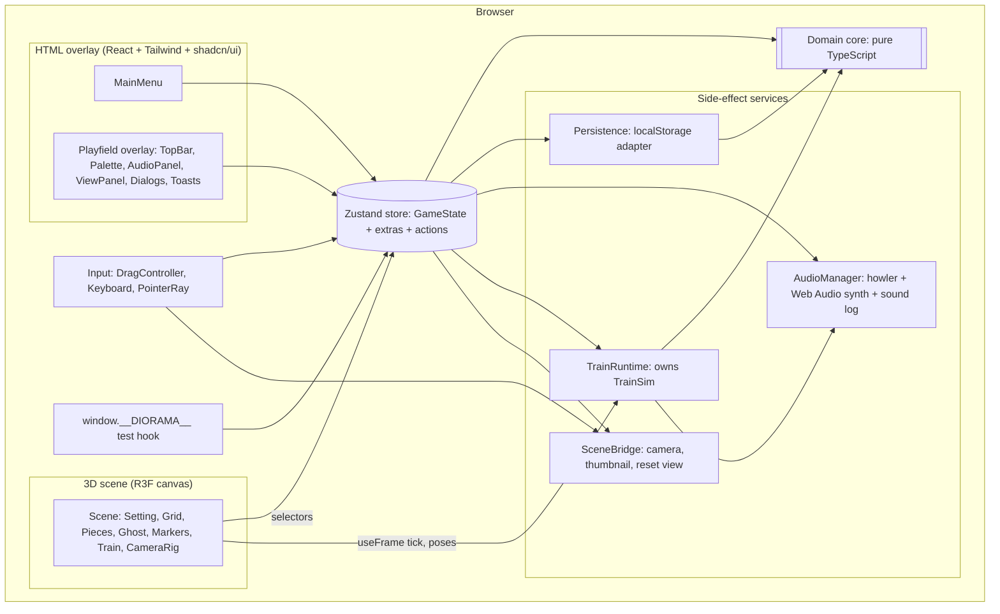
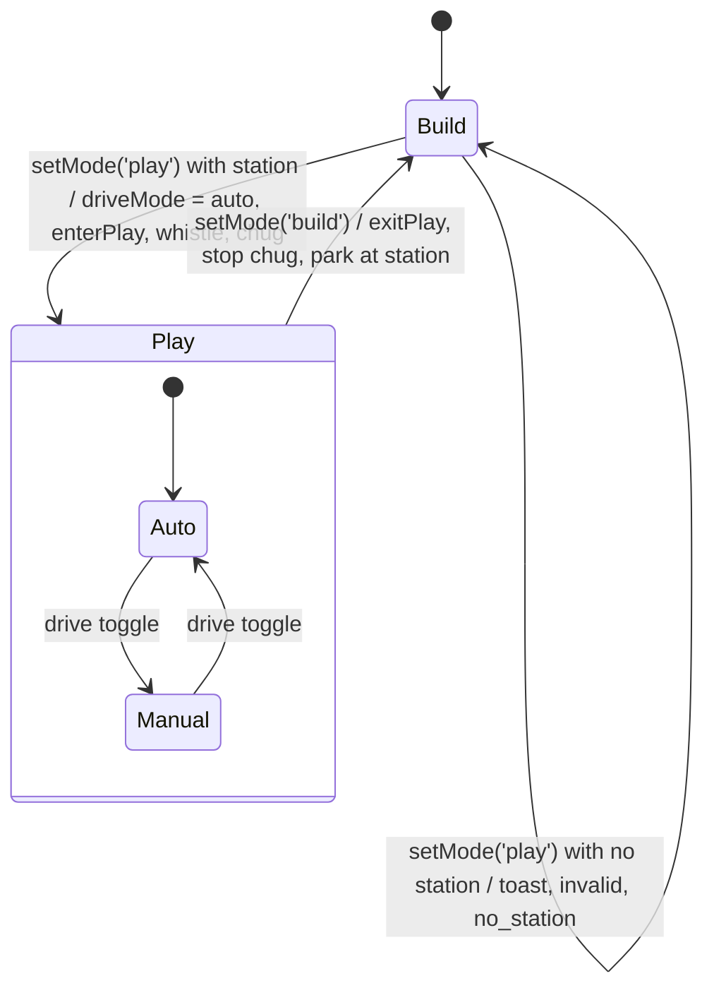
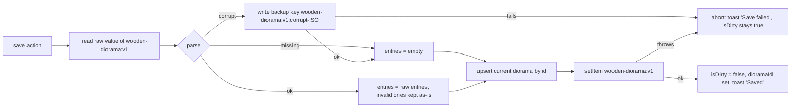
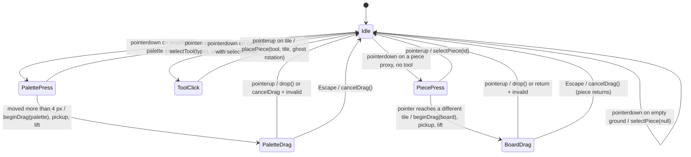

# Design Document: Track Diorama Builder

## Overview

Track is a single-page, client-only web app. The user builds a toy wooden train diorama on a 16 × 16 grid and then runs a locomotive with 2 carriages on the tracks they built. This document describes how the approved requirements (`requirements.md`, Requirements 1 to 42) will be implemented. `requirement.md` at the project root stays the single source of truth; nothing in this design overrides it.

The design rests on one idea: **all rules live in a framework-free domain core**. Placement validation, reason codes, connectors, connections, auto-adjust, undo history, track geometry, train simulation, save-file validation and autosave timing are plain TypeScript functions with no React, Three.js, Zustand or DOM imports. The Zustand store wraps that core and adds side effects (sound, persistence, toasts). The UI, the keyboard, the drag controller and the `window.__DIORAMA__` test hook all call the same store actions, so they cannot drift apart (Requirements 16.7, 39.17). The React Three Fiber scene only reads state and renders it.

### Goals

- Meet every Must criterion, and the Should and Could criteria where they do not risk a Must (Requirement 42).
- Implement the test contract in Section 10 of `requirement.md` exactly (Requirements 37 to 39).
- Hold at least 30 fps with 100 pieces on an Intel Iris Xe class GPU (Requirement 32).
- Keep the logic testable in Node with Vitest and fast-check, without a browser or WebGL.

### Key design decisions

| # | Decision | Rationale |
| --- | --- | --- |
| DD-1 | Pure domain core in `src/domain/`, no framework imports | Property tests run fast in Node; UI and test hook share one implementation |
| DD-2 | One Zustand store created by a factory `createAppStore(deps)` with injected storage, audio, clock, id generator, scene and train ports | The same store runs in the browser and in unit tests with fakes |
| DD-3 | Train simulation is a pure stepper (`stepTrain`) driven by a fixed 1/120 s sub-step from `useFrame`; per-frame train poses live in a `TrainRuntime` object, not in the store | Avoids 60 Hz React re-renders; deterministic and property-testable |
| DD-4 | All 12 pieces, the train and the setting props are built from Three.js primitives and swept profiles with procedural wood materials (the Section 8 fallback) | Exact control over the sizes in Requirement 28, bevels and matte materials in Requirement 29, and zero model download |
| DD-5 | Static pieces are drawn with drei `<Merged>` instancing (one instanced mesh per piece part); the selected, dragged, ghost and deleting pieces are drawn as ordinary meshes that share the same geometry | Instancing keeps draw calls flat at 100 pieces; ordinary meshes allow outlines and per-piece opacity |
| DD-6 | Camera uses drei `<CameraControls>` (camera-controls) with left button disabled, right = rotate, middle = truck, wheel = dolly, polar limits 20° to 80°, distance 4 to 30 and a target boundary box | Built-in limits, boundary clamping and animated `setLookAt` for Reset view |
| DD-7 | Pointer to tile mapping is a pure ray-plane intersection with y = 0, followed by `worldToTile` | No dependency on ground meshes; works for HTML palette drags and board drags alike |
| DD-8 | Drag follow and tilt use a small pure damped-spring integrator in `useFrame`; one-shot animations (lift, drop bounce, shake, rotate, delete fade, hover) use `@react-spring/three` | Tilt needs per-frame velocity; one-shot transitions read better as springs or eased tweens |
| DD-9 | Sound effects: CC0 Kenney files played with howler where suitable, Web Audio synthesis for any event without a file (planned: whistle and chug). Music: a CC0 file if one is found, otherwise `tone`, loaded only through a dynamic `import('tone')` | Meets the licence rules and Requirement 1.7 |
| DD-10 | Tunnel hiding uses an opaque dark "interior plug" box inside each tunnel shell, spanning the part of the tile more than 0.2 tiles from both openings | Ordinary depth testing hides the train from every camera angle; no stencil or clipping planes |

## Architecture

### Technology and versions

| Area | Package | Notes |
| --- | --- | --- |
| Language | TypeScript (strict) | `tsc -b` runs as part of `npm run build` |
| Build | Vite, `@vitejs/plugin-react` | `npm run dev`, `npm run build`, `npm run preview` |
| UI | React 19 | Required by @react-three/fiber 9 |
| Styling | Tailwind CSS 4 via `@tailwindcss/vite`, shadcn/ui components (Radix primitives), `clsx`, `tailwind-merge`, `class-variance-authority`, `lucide-react` | Tailwind is a dev dependency |
| 3D | `three`, `@react-three/fiber`, `@react-three/drei` | drei supplies CameraControls, Merged/Instances, RoundedBox, Outlines |
| State | `zustand` | Single store |
| Animation | `@react-spring/three` | One-shot tactile animations |
| Audio | `howler` | Files and shared Web Audio context; `tone` only for the music fallback |
| Ids | `nanoid` | Piece and diorama ids |
| Tests (dev) | `vitest`, `fast-check`, `jsdom`, `@testing-library/react`, `@testing-library/user-event`, `@playwright/test` | Dev dependencies only |

Exact versions are pinned in `package.json` when the project is scaffolded, choosing the latest stable releases that are mutually compatible (R3F 9 with React 19, drei 10, `@react-spring/three` with R3F 9). Node.js is v22.17.0 from `.nvmrc`.

### Layering



Rules for the layers:

1. `src/domain/` imports nothing outside itself (enforced by an ESLint `no-restricted-imports` rule or a Vitest check that scans import statements).
2. Only store actions change `GameState`. Components and the test hook never call `setState` directly.
3. The scene never mutates the store, except through actions the input layer calls.
4. Services are created once in `src/app/bootstrap.ts` and passed to `createAppStore`.

### Module layout

```text
index.html                      <title>Track</title>, #root
src/
  main.tsx                      bootstrap services, create store, install test hook, render <App/>
  App.tsx                       switches between <MainMenu/> and <Playfield/> on store.screen
  app/bootstrap.ts              builds storage, AudioManager, TrainRuntime, SceneBridge, store
  domain/
    types.ts                    Section 9 types, Dir, Tile, Reason, SoundEvent
    catalogue.ts                the 12 items: label, kind, footprint, connectors at 0°
    grid.ts                     tileCentre, worldToTile, footprintTiles, inGrid, tileKey
    connectors.ts               rotateDir, connectorsOf, opposite, dirDelta, nextRotation
    occupancy.ts                buildOccupancy(pieces)
    placement.ts                validate* and apply* for place, move, rotate, remove
    connections.ts              getConnections, connectionSet, openEnds, newConnections
    autoAdjust.ts               resolveAutoRotation
    history.ts                  HistoryEntry, record, undo, redo (limit 50)
    naming.ts                   nextUntitledName, validateName
    trackPath.ts                per-type local centreline, pointAt, tangentAt, length
    trackGraph.ts               buildTrackGraph, advance, distanceToDeadEnd
    train.ts                    TrainSim, parkTrain, stepTrain, vehiclePoses, snapshot
    autosave.ts                 autosave due-time rules
    saveFormat.ts               validateDiorama, validatePiece, parseSaveFile, parseAudioSettings, parseAppSettings
    color.ts                    hex to HSL, palette rule check
  persistence/
    storage.ts                  KeyValueStorage interface, localStorage adapter, memory adapter
    saveRepository.ts           load, upsert, rename, remove, corrupt backup
    settingsRepository.ts       audio and app settings
  audio/
    AudioManager.ts             play, chug loop, music, unlock, mute, volumes, sound log
    soundBank.ts                event to file or synth recipe
    synth.ts                    Web Audio recipes (knock, click, whistle, chug, bump, ...)
    music.ts                    file music via howler, or dynamic import('tone') fallback
  store/
    createAppStore.ts           state, actions, side-effect orchestration
    selectors.ts                derived data: occupancy, connections, open ends, station
    useAppStore.ts              React binding (useStore with selector)
  runtime/
    TrainRuntime.ts             enterPlay, exitPlay, tick, keys, snapshot, poses
    SceneBridge.ts              register camera/gl; captureThumbnail, resetView, rayFromClient
  testHook/installTestHook.ts   window.__DIORAMA__ (dynamic import, only when allowed)
  input/
    DragController.ts           palette and board drag state machine (window pointer events)
    useKeyboardShortcuts.ts     R, Delete, Backspace, Escape, F, W, S, undo, redo
  scene/
    Scene.tsx, CameraRig.tsx, Lighting.tsx, GridLines.tsx, TileHighlight.tsx
    settings/BedroomSetting.tsx, settings/KitchenSetting.tsx
    pieces/PieceLayer.tsx       instanced static pieces (drei Merged)
    pieces/ActivePiece.tsx      selected, dragged, ghost, exiting pieces (ordinary meshes)
    pieces/BlobShadows.tsx      instanced contact shadows
    pieces/OpenEndMarkers.tsx
    pieces/PickProxies.tsx      invisible hit boxes for pointer picking
    train/TrainView.tsx         loco + 2 carriages, imperative pose updates
    models/geometry.ts          sweepProfile, rail profile, rounded parts, per-type part lists
    models/materials.ts         procedural textures and shared materials
    animation/spring.ts         pure damped spring step
    animation/tactile.ts        timing constants, shake curve, tilt clamp
  ui/
    components/ui/*             shadcn: button, toggle, toggle-group, slider, alert-dialog, tooltip, toast
    MainMenu.tsx, DioramaCard.tsx, Playfield.tsx, TopBar.tsx, Palette.tsx,
    AudioPanel.tsx, ViewPanel.tsx, UnsavedChangesDialog.tsx, Toasts.tsx, icons.tsx
  theme/palette.ts              all colour tokens (overlay and materials)
tests/
  unit/**                       Vitest + fast-check (Node)
  component/**                  Vitest + jsdom + Testing Library
  e2e/**                        Playwright (Chromium, Firefox, WebKit)
public/assets/{models,textures,audio/sfx,audio/music}/
CREDITS.md, README.md
```

### Main flows

#### Build action (UI drop or test hook call)

```mermaid
sequenceDiagram
  participant Src as Drag controller or test hook
  participant St as Store action
  participant Dom as Domain core
  participant Au as AudioManager
  participant Sc as Scene (subscribed)
  Src->>St: placePiece(type, x, z, {rotation, autoAdjust})
  St->>Dom: applyBuild(ctx, request)
  Dom-->>St: outcome {ok, pieces, entry, sound, snap} or {ok:false, reason}
  alt ok
    St->>St: set pieces, push history, isDirty = true, schedule autosave
    St->>Au: play('place'), then play('snap') if snap
    St-->>Src: {ok:true, id}
    Sc->>Sc: re-render pieces, connections, markers; animate drop
  else rejected
    St->>Au: play('invalid')
    St-->>Src: {ok:false, reason}
  end
```

Store actions run synchronously, so a `getConnections()` or `getState()` call made right after a hook call sees the result (Requirements 14.9, 39.2).

#### Mode switch and train



#### Save



## Components and Interfaces

### 1. Domain core (`src/domain/`)

#### 1.1 Catalogue and connectors

```ts
export type Dir = 0 | 1 | 2 | 3;            // 0 = N (−Z), 1 = E (+X), 2 = S (+Z), 3 = W (−X)
export interface CatalogueItem {
  type: PieceType;
  label: string;                            // exactly the Item column, e.g. "Straight track"
  kind: 'track' | 'decoration';
  size: 1 | 2;                              // footprint edge length in tiles
  connectors0: readonly Dir[];              // ordered; index 0 is the progress-0 end
}
export const CATALOGUE: readonly CatalogueItem[]; // 12 entries in Section 6 order
export function itemOf(type: PieceType): CatalogueItem;
export function isPieceType(x: unknown): x is PieceType;
export function isTrackType(t: PieceType): t is TrackType;
export function isRotation(x: unknown): x is Rotation;

export function rotateDir(d: Dir, r: Rotation): Dir;        // (d + r / 90) mod 4
export function opposite(d: Dir): Dir;                      // (d + 2) mod 4
export function dirDelta(d: Dir): { dx: number; dz: number }; // N (0,−1), E (1,0), S (0,1), W (−1,0)
export function connectorsOf(p: Pick<Piece, 'type' | 'rotation'>): Dir[];
export function nextRotation(r: Rotation): Rotation;        // 0→90→180→270→0
```

Connector order at 0°: `straight`, `tunnel`, `station` = [N, S]; `curve` = [S, E]; `buffer` = [S]; decorations = []. The order defines `progress` (Requirement 39.13, Assumption 14): progress 0 is at connector index 0 and progress 1 at index 1, or at the stop block for the buffer.

#### 1.2 Grid

```ts
export const GRID = 16;
export function tileCentre(gridX: number, gridZ: number): { x: number; z: number }; // x = gridX − 7.5
export function worldToTile(x: number, z: number): Tile | null;
// null unless −8 ≤ x < 8 and −8 ≤ z < 8; otherwise { gridX: floor(x + 8), gridZ: floor(z + 8) }
export function footprintTiles(type: PieceType, gridX: number, gridZ: number): Tile[];
// size 1: [anchor]; hill: anchor, east, south, south-east
export function footprintCentre(type: PieceType, gridX: number, gridZ: number): { x: number; z: number };
export function inGrid(t: Tile): boolean;   // integers 0..15
export const tileKey = (t: Tile) => t.gridZ * GRID + t.gridX;
```

`floor(x + 8)` gives the tile with the nearest centre, and a point exactly on a shared edge goes to the east or south tile (Requirement 2.3).

#### 1.3 Placement engine

```ts
export type Reason = 'occupied' | 'out_of_bounds' | 'on_track' | 'station_limit'
                   | 'no_station' | 'play_mode' | 'not_found';

export type BuildRequest =
  | { kind: 'place'; type: unknown; gridX: unknown; gridZ: unknown;
      rotation?: unknown; autoAdjust: boolean }
  | { kind: 'move'; id: unknown; gridX: unknown; gridZ: unknown; rotation?: Rotation }
  | { kind: 'rotate'; id: unknown }
  | { kind: 'remove'; id: unknown };

export interface BuildContext {
  pieces: readonly Piece[];
  mode: 'build' | 'play';
  newId: () => string;
}

export type BuildOutcome =
  | { ok: true; pieces: Piece[]; entry: HistoryEntry | null; id?: string;
      sound: 'place' | 'move' | 'rotate' | 'delete'; snap: boolean }
  | { ok: false; reason: Reason };

export function applyBuild(ctx: BuildContext, req: BuildRequest): BuildOutcome;

/** Ghost tint and drop validity: null means valid. Excludes the piece being moved. */
export function checkFootprint(pieces: readonly Piece[], type: PieceType,
  gridX: number, gridZ: number, opts?: { movingId?: string; isNew?: boolean }): Reason | null;
```

Validation order, first match wins (Requirement 16.12, Assumption 1):

1. `play_mode`: `ctx.mode === 'play'`.
2. `not_found`: `move`, `rotate` or `remove` id matches no piece; `place` with an unknown `type`, or a `rotation` that is present but not 0, 90, 180 or 270.
3. `out_of_bounds`: `gridX` or `gridZ` is not an integer, or any footprint tile is outside 0 to 15.
4. `station_limit`: `place` of a `station` while one exists.
5. `on_track`: a decoration's footprint includes a tile that holds a track (other than the moving piece).
6. `occupied`: any footprint tile holds a piece other than the moving piece.

`rotate` can only fail with `play_mode` or `not_found`, because every track is 1 × 1 and the hill footprint does not change with rotation (Assumption 6). `remove` likewise.

Successful outcomes:

- `place`: appends `{ id: newId(), type, gridX, gridZ, rotation }` to the end of `pieces`. The rotation is the given one, or 0 when omitted, then passed through `resolveAutoRotation` when `autoAdjust` is true. `entry = { kind: 'place', piece, index }`.
- `move`: replaces the piece in place (same array index), keeps `id` and `type`, sets the new anchor and, for UI drags, the rotation shown at release. A move to the same tile with the same rotation returns `ok: true`, `entry: null` and leaves `pieces` unchanged (Requirement 39.4, Assumption 7). `move` never applies auto-adjust (Requirement 15.7).
- `rotate`: sets `rotation = nextRotation(rotation)`; `entry = { kind: 'rotate', id, from, to }`.
- `remove`: deletes the piece and records `{ kind: 'remove', piece, index }` so undo can reinsert it at the same index.
- `snap` is true when `newConnections(before, after)` is non-empty. It is always false for `remove`.

#### 1.4 Connections

```ts
export function getConnections(pieces: readonly Piece[]): Array<[string, string]>;
// each pair once, ids in a pair sorted, pairs sorted lexicographically (Requirement 39.12)
export function openEnds(pieces: readonly Piece[]): Array<{ pieceId: string; tile: Tile; dir: Dir }>;
export function newConnections(before: readonly Piece[], after: readonly Piece[]): Array<[string, string]>;
export function neighbourAcross(index: OccupancyIndex, piece: Piece, dir: Dir):
  { piece: Piece; connectorIndex: number } | null;
```

Two tracks A and B are connected when B's tile is `A.tile + dirDelta(d)` for some connector `d` of A, and B has connector `opposite(d)`. Decorations have no connectors, so they never connect. Tiles off the grid hold nothing, so a connector facing the boundary is an open end (Assumption 41). The function builds an occupancy index once (O(n)) and checks at most 2 connectors per track.

#### 1.5 Auto-adjust

```ts
export function resolveAutoRotation(pieces: readonly Piece[], type: PieceType,
  gridX: number, gridZ: number, current: Rotation): Rotation;
```

1. If `type` is a decoration, return `current`.
2. If no edge-adjacent track has a connector facing the target tile, return `current`. Because the target tile is free, any such facing connector is an open end.
3. If `current` already creates a connection, return `current` (Requirement 15.6).
4. Try `current + 90`, `+ 180`, `+ 270` (mod 360) in that order and return the first that creates at least one connection (Requirement 15.1).
5. Otherwise return `current` (Requirement 15.2).

#### 1.6 History

```ts
export type HistoryEntry =
  | { kind: 'place'; piece: Piece; index: number }
  | { kind: 'remove'; piece: Piece; index: number }
  | { kind: 'move'; id: string; from: Placement; to: Placement } // Placement = {gridX, gridZ, rotation}
  | { kind: 'rotate'; id: string; from: Rotation; to: Rotation };
export interface History { past: HistoryEntry[]; future: HistoryEntry[] }
export const HISTORY_LIMIT = 50;
export function record(h: History, e: HistoryEntry): History;   // push, drop oldest past 50, clear future
export function undo(h: History, pieces: readonly Piece[]): { history: History; pieces: Piece[] } | null;
export function redo(h: History, pieces: readonly Piece[]): { history: History; pieces: Piece[] } | null;
```

Undo applies the exact inverse without re-validating. History is linear, so the inverse always restores a state that existed and was valid. Redo re-applies the recorded entry, which recreates the same ids and values (Requirement 13.4). The limit of 50 exceeds the required 20 (Requirement 13.2).

#### 1.7 Naming

```ts
export function nextUntitledName(savedNames: readonly string[]): string;
// "Untitled diorama" if free, otherwise "Untitled diorama N" for the smallest free N ≥ 2
export function validateName(input: string): { ok: true; name: string } | { ok: false };
// trims; valid when 1..40 characters after trimming
```

Length counts UTF-16 code units (`string.length`), which matches the `maxLength` attribute on the input. This is a recorded decision (D-14).

#### 1.8 Track path geometry (`trackPath.ts`)

Local coordinates have the origin at the tile (or footprint) centre, +x east and +z south. A clockwise rotation by 90° maps (x, z) to (−z, x). In Three.js this is `rotation.y = −rotation × π / 180`.

| Type | Centreline at 0° | Length L (tiles) |
| --- | --- | --- |
| `straight`, `tunnel`, `station` | Line from N midpoint (0, −0.5) to S midpoint (0, 0.5) | 1 |
| `curve` | Quarter circle, centre (0.5, 0.5) (the SE corner), radius 0.5, from S midpoint (0, 0.5) to E midpoint (0.5, 0) | π/4 ≈ 0.785 |
| `buffer` | Line from S midpoint (0, 0.5) to the stop block face (0, −0.25) | 0.75 |

```ts
export function pathLength(type: TrackType): number;
export function pointAt(piece: Piece, s: number): { x: number; z: number };      // world, 0 ≤ s ≤ L
export function tangentAt(piece: Piece, s: number): { x: number; z: number };    // unit, toward +s
```

`progress = s / L`. The stop block occupies the north 0.25 of the buffer tile, so the train's leading end rests against its face.

#### 1.9 Track graph

```ts
export interface EndLink { pieceId: string; end: 0 | 1 }   // end 0 is s = 0, end 1 is s = L
export interface GraphNode { piece: Piece; length: number; links: [EndLink | null, EndLink | null] }
export interface TrackGraph { nodes: Map<string, GraphNode> }
export interface TrackLoc { pieceId: string; s: number; heading: 1 | -1 }  // heading: direction of travel in s

export function buildTrackGraph(pieces: readonly Piece[]): TrackGraph;
export function advance(g: TrackGraph, loc: TrackLoc, dist: number):
  { loc: TrackLoc; moved: number; blocked: boolean };
export function distanceToDeadEnd(g: TrackGraph, loc: TrackLoc, max: number): number; // Infinity if none within max
export function walkPose(g: TrackGraph, loc: TrackLoc, dist: number):
  { x: number; z: number; tangent: { x: number; z: number }; onTrack: boolean; pieceId: string | null };
```

`links[k]` is the neighbour joined through connector `k`. A buffer's end 1 is the stop block and is always `null`. `advance` moves along the current piece; on reaching an end it follows the link and enters the neighbour at `s = 0` with heading +1 (entered through connector 0) or at `s = L` with heading −1 (entered through connector 1). A `null` link is a dead end: `advance` stops exactly there and returns `blocked: true` with `moved < dist`. `walkPose` uses the same walk; past a dead end it continues on a straight extension along the end tangent and reports `onTrack: false` (Requirement 19.10).

The graph is rebuilt only when `pieces` changes (memoised by array identity). In Play mode `pieces` cannot change.

#### 1.10 Train simulation (`train.ts`)

Constants (tiles, seconds):

| Constant | Value | Source |
| --- | --- | --- |
| Locomotive length | 0.9 | Section 6 |
| Carriage length | 0.8 | Section 6 |
| Coupling gap | 0.1 | D-15 |
| Centre spacing loco to carriage 1 | 0.95 (0.45 + 0.1 + 0.4) | derived |
| Centre spacing carriage 1 to carriage 2 | 0.9 (0.4 + 0.1 + 0.4) | derived |
| Auto cruise speed | 1.5 | AC-10.6 |
| Auto departure acceleration | 6 per s² (0.25 s to cruise) | D-16 |
| Braking deceleration (auto and manual dead-end envelope) | 3 per s² | D-16 |
| Manual acceleration | 2 per s² (0 to 2 in 1 s) | Requirement 21.3 |
| Manual top speed | 2 | AC-10.7 |
| Manual coast and reverse braking | 5 per s² (2 to 0 in 0.4 s) | Requirement 21.4 |
| Auto pause at dead end | 1.0 s | AC-10.6 |
| Whistle throttle | 3 s | Requirement 26.1 |
| Sub-step | 1/120 s; a frame `dt` above 0.1 s is clamped to 0.1 s | D-17 |

```ts
export interface TrainSim {
  loco: TrackLoc;               // locomotive centre; heading = the way the locomotive faces
  speed: number;                // ≥ 0
  direction: 'forward' | 'reverse';
  phase: 'parked' | 'running' | 'braking' | 'paused' | 'stopped' | 'blocked';
  pauseLeft: number;            // seconds left in the auto pause
  deadEnd: 'forward' | 'reverse' | null; // direction in which the train is resting against a dead end
  lastWhistleAt: number;        // simulation clock, −Infinity initially
  clock: number;
}
export interface DriveInput { driveMode: 'auto' | 'manual'; w: boolean; s: boolean }
export type TrainEvent = 'whistle' | 'chugStart' | 'chugStop' | 'bump';

export function parkTrain(g: TrackGraph, station: Piece, startFacing: 0 | 180): TrainSim;
export function startPlay(g: TrackGraph, sim: TrainSim): { sim: TrainSim; events: TrainEvent[] };
export function stepTrain(g: TrackGraph, sim: TrainSim, input: DriveInput, dt: number):
  { sim: TrainSim; events: TrainEvent[] };
export function vehiclePoses(g: TrackGraph, sim: TrainSim): VehiclePose[];   // [loco, car1, car2]
export function snapshot(g: TrackGraph, sim: TrainSim): TrainSnapshot;       // getTrain() shape
```

Behaviour:

- **Parking.** The locomotive centre is at `s = 0.5` on the station (progress 0.5). `startFacing` 0 gives `heading = −1`, so the locomotive faces connector 0, the station's rotated north connector. `startFacing` 180 gives `heading = +1`, facing the other connector (Requirements 17.4, 17.5). `direction = 'forward'`, `speed = 0`, `moving = false`.
- **Leading end.** Forward: the locomotive front, 0.45 ahead of the locomotive centre along `heading`. Reverse: the rear of carriage 2, 0.95 + 0.9 + 0.4 = 2.25 behind the centre. Dead-end distance is measured from the leading end with `distanceToDeadEnd`. If the walk back from the centre leaves the track before reaching the leading end (trailing vehicles on the extension), the free distance in that direction is 0.
- **Speed envelope.** In every phase the speed is capped by `sqrt(2 × 3 × D)`, where D is the free distance ahead of the leading end. This lowers the speed monotonically to 0 exactly at the dead end, so the leading end never passes it (Requirements 20.3, 21.5). Each sub-step moves `min(speed × h, D)`; when D falls below 1e-4 the train snaps to the dead end, `speed = 0`, and emits `bump` and `chugStop` once.
- **Auto.** Accelerate at 6 per s² up to 1.5 and hold it. At a dead end: `phase = 'paused'` for 1 s with `moving: false`, then flip `direction`, emit `whistle` (throttled) and `chugStart`, and run. If the free distance in the new direction is also 0 (for example a lone station whose carriages hang off both ends), the phase becomes `'blocked'`: the train stays still and no more sounds play until the drive mode or mode changes (D-18). On a closed loop D stays Infinity, so the train cruises indefinitely (Requirement 20.5).
- **Manual.** Thrust exists when exactly one of W or S is held. The requested direction is forward for W and reverse for S. If the requested direction differs from `direction` and `speed > 0`, brake at 5 per s² until 0, then switch `direction` (it never flips while moving, Requirement 21.7). Otherwise accelerate at 2 per s² up to 2. With no thrust, brake at 5 per s². At a dead end in direction d, holding the key for d keeps the train still; the other key moves it away (Requirement 21.6).
- **Drive-mode switches.** Manual to auto: keep `direction` and accelerate to 1.5. If the train is resting at a dead end in that direction, apply the 1 s pause and reversal (Requirement 20.7). Auto to manual with no key: braking at 5 per s² stops within 0.3 s (Requirement 20.8).
- **Events.** `chugStart` when speed rises above 0 from 0, `chugStop` when speed reaches 0, `bump` when coming to rest at a dead end (not when stopping mid-track, Requirement 26.6), and `whistle` on every departure from standstill, at most once per 3 s of simulation time (Requirement 26.1).
- **Vehicle poses.** Each vehicle centre is found by `walkPose` from the locomotive centre, back along the track by 0.95 and 1.85. Each centre lies on the centreline and each heading equals the tangent, so Requirements 19.3 and 19.4 hold exactly up to floating-point error. In reverse the same placement holds; only the travel direction changes.
- **`snapshot`.** `{ pieceId: loco.pieceId, progress: loco.s / L, moving: speed > 0, direction, speed }`. The locomotive centre never leaves the track: forward motion stops when the front reaches a dead end, which is 0.45 ahead of the centre, and in reverse the rear reaches any dead end first.

Visual overlap: the 0.5-tile curve radius is fixed by Section 6. On two curves placed back to back (a U-turn), the rigid bodies of adjacent vehicles can touch at their inner corners even though their centre spacing along the track stays exact. Vehicles have rounded, slightly tapered ends to reduce this; it is listed as a known limitation in the README (D-19).

#### 1.11 Autosave rule (`autosave.ts`)

```ts
export const AUTOSAVE_MS = 30_000;
export function nextAutosaveDue(prev: number | null, event:
  | { kind: 'dirtied'; now: number }        // isDirty changed false → true
  | { kind: 'attempted'; now: number; stillDirty: boolean }
  | { kind: 'returnedToBuild'; now: number; dirty: boolean }
  | { kind: 'cleaned' }): number | null;
export function isAutosaveDue(dueAt: number | null, now: number, mode: 'build' | 'play', dirty: boolean): boolean;
```

The store keeps `autosaveDueAt`. A 1-second interval calls `isAutosaveDue`, so autosave fires 30 s to 31 s after the trigger (Requirement 23.1 allows ±1 s). No writes happen in Play mode or when the diorama is clean (Requirement 23.5).

#### 1.12 Save format validation (`saveFormat.ts`)

```ts
export type SaveLoad =
  | { status: 'missing' }
  | { status: 'corrupt'; raw: string }
  | { status: 'ok'; entries: unknown[]; valid: Diorama[]; invalidCount: number };
export function parseSaveFile(raw: string | null): SaveLoad;
export function validateDiorama(x: unknown): Diorama | null;   // rules from Requirement 24.1
export function validatePiece(x: unknown): Piece | null;
export function parseAudioSettings(raw: string | null): { settings: AudioSettings; warn: boolean };
export function parseAppSettings(raw: string | null): { settings: AppSettings; warn: boolean };
export function sortNewestFirst(d: readonly Diorama[]): Diorama[];   // by updatedAt desc, then id asc
```

- `parseSaveFile` never throws. `JSON.parse` runs in `try/catch`. Anything that is not `{ version: 1, dioramas: [] }` (an object with `version === 1` and an array `dioramas`) is `corrupt`. The empty string is `corrupt`.
- ISO 8601 check: matches `^\d{4}-\d{2}-\d{2}T\d{2}:\d{2}(:\d{2}(\.\d+)?)?(Z|[+-]\d{2}:\d{2})$` and `Date.parse` is not NaN.
- A diorama whose pieces contain duplicate ids, or two pieces whose footprints overlap, or more than one station, fails validation too. Such data cannot come from this app and would break the placement invariants (D-20).
- Audio settings: invalid JSON or a non-object gives all defaults (unmuted, 0.5, 0.8) and a warning. Inside a parsed object, each field that is invalid falls back to its own default, and one warning is logged (Requirements 24.4, 27.12, D-21).

### 2. Persistence (`src/persistence/`)

```ts
export interface KeyValueStorage {
  getItem(key: string): string | null;
  setItem(key: string, value: string): void;   // may throw (quota, SecurityError)
  keys(): string[];
}
export function browserStorage(): KeyValueStorage;   // wraps window.localStorage; falls back to memory if access throws
export function memoryStorage(init?: Record<string, string>, opts?: { failWrites?: () => boolean }): KeyValueStorage;

export interface SaveRepository {
  list(): Diorama[];                                       // newest first; logs one warning per skipped entry or one for a corrupt file
  get(id: string): Diorama | null;
  upsert(d: DioramaDraft, now: Date): WriteResult<Diorama>; // new id + createdAt on first save
  rename(id: string, name: string, now: Date): WriteResult<Diorama>;
  remove(id: string): WriteResult<void>;
}
export type WriteResult<T> = { ok: true; value: T } | { ok: false; error: 'write_failed' | 'backup_failed' | 'not_found' };
```

Write algorithm (all writes: upsert, rename, remove):

1. Read and parse the current raw value. Warnings are not logged on this internal read; only `list()` logs, so each menu load logs exactly once per bad entry.
2. If `corrupt`, copy the raw string to `wooden-diorama:v1:corrupt-<ISO timestamp>`. If that key already exists, append `-2`, `-3` and so on. Existing backup keys are never written again (Requirement 24.3). If the backup write throws, return `backup_failed` and do not touch `wooden-diorama:v1` (Requirement 24.8).
3. Start from the raw `entries` array (invalid entries are kept unchanged, Requirement 24.7). Replace the entry whose `id` matches, or append.
4. `setItem(SAVE_KEY, JSON.stringify({ version: 1, dioramas }))`. `setItem` replaces the value atomically, so on a throw the old value remains (Requirement 36.7).

Upsert details: the first save assigns `id = nanoid()`, `createdAt = updatedAt = now.toISOString()` (UTC, Requirement 36.3). Later saves keep `id` and `createdAt` and set `updatedAt = now`. Rename sets `updatedAt` and keeps `thumbnail` (Requirements 6.6, 36.4). `updatedAt` is never earlier than `createdAt`: if the clock went backwards, `updatedAt = createdAt`.

`SettingsRepository` reads and writes `wooden-diorama:audio` (`{ muted, musicVolume, sfxVolume }`) and `wooden-diorama:settings` (`{ lowQuality }`). Write failures for these keys log a warning and keep the in-memory value; no toast, because they are not saves of user work.

### 3. Store (`src/store/createAppStore.ts`)

```ts
export interface AppDeps {
  storage: KeyValueStorage;
  saves: SaveRepository;
  settings: SettingsRepository;
  audio: AudioPort;          // play(event), setChugLevel(v), stopChug(), apply(settings)
  train: TrainPort;          // enterPlay, exitPlay, setDriveMode, snapshot
  scene: ScenePort;          // captureThumbnail(): string | null, resetView()
  now: () => number;
  newId: () => string;       // nanoid
  warn: (msg: string, data?: unknown) => void;  // console.warn
}
export function createAppStore(deps: AppDeps): StoreApi<AppState>;
```

Actions (each returns synchronously):

| Group | Action | Notes |
| --- | --- | --- |
| Menu | `refreshList()`, `newDiorama()`, `openDiorama(id)`, `renameDiorama(id, name)`, `requestDeleteDiorama(id)`, `confirmDialog()`, `cancelDialog()`, `discardAndLeave()` | Rename and delete write through `saves` |
| Navigation | `backToMenu()` | Opens the unsaved-changes dialog when `isDirty` |
| Palette | `selectTool(type \| null)` | Ignored in Play mode or for a disabled station |
| Build | `placePiece(type, x, z, opts)`, `movePiece(id, x, z, rotation?)`, `rotatePiece(id)`, `removePiece(id)`, `deleteSelected()`, `selectPiece(id \| null)`, `undo()`, `redo()` | All call `applyBuild`; return `{ ok, id?, reason? }` |
| Drag | `beginDrag(src)`, `setDragTile(tile \| null)`, `rotateDrag()`, `drop()`, `cancelDrag()` | `drop` calls `placePiece` or `movePiece`; off-grid drops play `invalid` |
| Modes | `setMode(mode)`, `setDriveMode(m)`, `toggleDriveMode()`, `flipStartFacing()`, `setSetting(s)` | `setMode` returns `{ ok, reason? }` |
| Save | `save(trigger: 'manual' \| 'autosave' \| 'dialog')` | Captures a thumbnail, upserts, toasts |
| Audio | `setMuted(b)`, `setMusicVolume(v)`, `setSfxVolume(v)` | Persists to `wooden-diorama:audio` |
| Quality | `setLowQuality(b)` | Persists to `wooden-diorama:settings` |
| Toasts | `pushToast(text, tone)`, `dismissToast(id)` | Auto-dismiss after 3 s |

Side-effect rules inside actions:

- A successful build action: set `pieces`, `record` the history entry (when not null), set `isDirty = true`, update `autosaveDueAt` if `isDirty` was false, clear `selectedPieceId` if that piece is gone, then `audio.play(sound)` and `audio.play('snap')` when `snap`. A rejected one: `audio.play('invalid')` and no state change (Requirement 16.11).
- `undo` and `redo` are ignored in Play mode, during a drag, or with nothing to undo or redo. They play no sound (Assumption 40).
- `selectTool('station')` while a station exists is a no-op. The palette also blocks it.
- `setMode('play')`: no station → toast "Place a station to start", `invalid`, `{ ok: false, reason: 'no_station' }`. Otherwise cancel any drag, clear `selectedPieceId` and `hoverTile`, set `mode = 'play'`, `driveMode = 'auto'`, call `train.enterPlay(pieces, startFacing)` (which plays `whistle` and `chug`). `isDirty` is unchanged (Requirement 18.6). Calling `setMode` with the current mode returns `{ ok: true }` and does nothing else.
- `setMode('build')`: `train.exitPlay()` (stops the chug), `mode = 'build'`, reset `autosaveDueAt` if dirty.
- `flipStartFacing()` only in Build mode; sets `isDirty`.
- `setSetting(s)` with a different value sets `setting` and `isDirty`; allowed in both modes (Assumption 20).
- `newDiorama()`: name from `nextUntitledName(saves.list().map(d => d.name))`, clears history and all transient fields (Requirement 35.6).
- `openDiorama(id)`: loads from `saves.get(id)`, copies pieces in saved order, clears history (Requirement 13.10).
- `save()`: if `scene.captureThumbnail()` throws or returns null, the diorama is saved without `thumbnail` (Requirement 6.4). On success: `dioramaId`, `isDirty = false`, `autosaveDueAt = null`, toast "Saved". On failure: toast "Save failed. Your changes are still here.", `isDirty` stays true; an autosave failure sets `autosaveDueAt = now + 30 s` (Requirement 23.4). After a dialog-triggered save succeeds, the screen changes to the menu; after it fails, the playfield stays open.

### 4. Train runtime (`src/runtime/TrainRuntime.ts`)

```ts
export class TrainRuntime implements TrainPort {
  constructor(audio: AudioPort, getState: () => AppState);
  enterPlay(pieces: Piece[], startFacing: 0 | 180): void;
  exitPlay(): void;
  setKeys(keys: { w: boolean; s: boolean }): void;   // keyboard hook; cleared on window blur
  tick(frameDt: number): void;                       // called from useFrame; runs 1/120 s sub-steps
  poses(): VehiclePose[] | null;                     // read by TrainView each frame
  snapshot(): TrainSnapshot | null;                  // getTrain()
}
```

In Build mode `snapshot()` and `poses()` derive the parked train from the store's current `pieces` and `startFacing`, memoised on those two values. The parked train therefore follows station moves, rotations, undo and redo (Requirement 17.2), and is `null` with no station (Requirement 17.9). In Play mode `tick` advances the sim and forwards events to the audio manager: `whistle`, `chugStart` → `audio.startChug()` (logs `chug`), `chugStop` → `audio.stopChug()`, `bump`. It also calls `audio.setChugLevel(speed / 2)` every frame (at least 10 times per second, Requirement 26.3).

`tick` uses real frame time, so it pauses when the tab is hidden (requestAnimationFrame stops). That is acceptable for a toy.

### 5. Test hook (`src/testHook/installTestHook.ts`)

`main.tsx` evaluates `import.meta.env.DEV || new URLSearchParams(location.search).get('test') === '1'` once at load. When true, it dynamically imports the hook module and assigns `window.__DIORAMA__` before the first React render, so the hook exists when the main menu first appears and for the page's whole lifetime (Requirements 38.1 to 38.5). In a production build without `?test=1` the module is never loaded and `window.__DIORAMA__` stays undefined.

| Hook method | Implementation |
| --- | --- |
| `getState()` | Plain-object copy of the Section 9 fields plus serialisable extras (`screen`, `history` sizes, `lowQuality`, audio settings) |
| `placePiece(t, x, z, r?)` | `store.placePiece(t, x, z, { rotation: r, autoAdjust: r === undefined })` |
| `movePiece(id, x, z)` | `store.movePiece(id, x, z)` (rotation kept) |
| `rotatePiece(id)`, `removePiece(id)` | Same store actions as the R key and Delete key |
| `getConnections()` | `getConnections(state.pieces)` |
| `setMode(m)` | `store.setMode(m)` |
| `setDriveMode(m)` | `store.setDriveMode(m)` (sets the field in any mode, Requirement 39.11) |
| `getTrain()` | `trainRuntime.snapshot()` |
| `getSoundLog()` | `audio.getLog()` copy |

Hook calls log the same sounds as the UI except `pickup` (Requirement 39.16). An invalid `type` or `rotation` returns `not_found` (Assumption 2).

### 6. Audio manager (`src/audio/`)

```ts
export type SoundEvent = 'pickup' | 'place' | 'move' | 'rotate' | 'delete' | 'snap'
                       | 'invalid' | 'ui' | 'whistle' | 'chug' | 'bump';
export interface AudioPort {
  play(e: Exclude<SoundEvent, 'chug'>): void;
  startChug(): void;            // logs 'chug' once per start
  setChugLevel(speedRatio: number): void;
  stopChug(): void;
  apply(settings: AudioSettings): void;
  getLog(): SoundEvent[];
}
```

- **Sound log.** `play` and `startChug` append the event name first, synchronously and always, whether or not audio is muted or unlocked (Requirements 25.12, 39.15). The log is capped at 10,000 entries (oldest dropped), which no test approaches.
- **Unlock.** A one-time `pointerdown` / `keydown` listener on `window` (capture phase) resumes the Web Audio context (`Howler.ctx.resume()`) and starts the music. Before unlock, `play` logs but produces no sound, and nothing queued is played later (Requirement 27.5).
- **Sources.** `soundBank.ts` maps each event to `{ kind: 'file'; src: string[] }` or `{ kind: 'synth'; recipe }`. Files are preloaded as decoded Web Audio buffers (`html5: false`) at app start so playback starts within a few milliseconds (Requirement 25.11). If a file fails to load, the event falls back to its synth recipe and a warning is logged.
- **Synthesis.** Recipes use the Howler context and connect to `Howler.masterGain`, so mute and master volume apply to both kinds: a wood knock is a short noise burst through a band-pass (900 to 2,000 Hz, Q 8) with a 60 to 120 ms exponential decay plus a sine partial; the whistle is two detuned sines at about 1,100 and 1,320 Hz with a slow attack and vibrato; the chug is a looping 4-beat noise-burst pattern whose rate follows speed; the bump is a low (120 Hz) damped sine with soft noise. Place, delete and invalid use different recipes or files, so they never share a clip (Requirement 25.8).
- **Volumes.** Effective effects gain = `muted ? 0 : sfxVolume`; music gain = `muted ? 0 : musicVolume`. Chug gain = `sfxVolume × speed / 2` (Requirement 26.3). Slider changes update live sounds immediately (Requirement 27.11). Unmuting restores the volumes held before muting, because mute does not change the stored volumes (Requirement 27.10).
- **Music.** If `public/assets/audio/music/` contains the sourced track, a looping `Howl` plays it. Otherwise `music.ts` runs `await import('tone')` and plays a generated loop: about 92 BPM, a I–vi–IV–V progression in a major key on a plucked marimba-like synth, a soft pad and a light brush-noise beat. The music keeps playing across the menu and the playfield (Requirement 27.1).
- **Shared context.** `tone` is pointed at Howler's context with `Tone.setContext(new Tone.Context(Howler.ctx))`, so a single unlock covers both.

### 7. Rendering (`src/scene/`)

#### 7.1 Canvas

```tsx
<Canvas
  dpr={lowQuality ? Math.min(devicePixelRatio, 1) : Math.min(devicePixelRatio, 1.5)}
  shadows={lowQuality ? false : 'soft'}     // PCFSoftShadowMap
  gl={{ antialias: true, powerPreference: 'high-performance' }}   // same in both qualities (D-35)
  camera={{ fov: 40, near: 0.1, far: 120 }}
  onContextMenu={(e) => e.preventDefault()}
/>
```

The canvas container is `position: fixed; inset: 0`, and R3F's resize observer keeps the canvas at viewport size (Requirements 2.1, 2.8). The DPR is recomputed on `resize` and when `lowQuality` changes, without reloading the page (Requirement 33.3).

#### 7.2 Materials and textures

- `materials.ts` generates textures once on the CPU with a 2D canvas: a 512 × 512 wood-grain texture (ring and streak pattern from layered sine-warped value noise), a 1024 × 1024 floorboard texture, a 512 × 512 felt noise texture and a 512 × 512 tabletop texture. All are at most 1024 × 1024.
- Shared material classes: `woodMaterial(tint)` (`MeshStandardMaterial`, grain map, roughness 0.72, metalness 0), `paintMaterial(colour)` (roughness 0.65), `plasticMaterial(colour)` (roughness 0.42, for the car's and the train's wheels), `feltMaterial` (roughness 0.95). Materials are cached by key, so all pieces of a type share them (Requirement 32.5).
- No environment map is used, so surfaces cannot reflect other objects (Requirement 29.1).
- Every colour comes from `theme/palette.ts`, and a unit test checks each token against the HSL limits (Requirement 30.3).
- Bevels: boxes use `RoundedBoxGeometry` (radius at least 0.03), cylinders get a chamfer ring, and the rail profile has 0.025 rounded top edges (Requirement 29.4).

#### 7.3 Geometry

- `sweepProfile(profile: Vector2[], path: (t) => {point, tangent}, segments)` builds a `BufferGeometry` by sweeping a closed 2D profile along a centreline. The rail profile is 0.30 wide × 0.08 high with two 0.05-wide, 0.025-deep grooves 0.16 apart. Straight, tunnel, station and buffer rails use 1 segment; the curve uses 16.
- Each piece type is defined as a list of parts `{ geometry, material }`. Parts with the same material within a type are merged with `BufferGeometryUtils.mergeGeometries`, so most types have 1 to 3 parts.
- Sizes follow Requirement 28: house 1.0 tall, pine tree 1.2, round tree 1.0, hill 0.6 peak (a lathe of a cosine profile, scaled to 2 × 2), car 0.5 × 0.3, cassette 0.68 × 0.43 × 0.08, blocks 3 × 0.28 cubes with letters from a small canvas texture (A, B, C).
- The station platform and roof stay inside the tile. The tunnel shell is an extruded arch 0.9 wide and 0.55 high with an opaque interior plug from s = 0.2 to s = 0.8 (DD-10). The plug is coloured dark walnut so it reads as tunnel shadow.

#### 7.4 Piece layers

| Layer | Contents | Technique |
| --- | --- | --- |
| `PieceLayer` | All placed pieces except the active ones | drei `<Merged meshes={partsByType}>`; each piece is an `animated.group` wrapping instance components. Instances inherit the group transform, so hover lift and drop bounce work per piece |
| `ActivePiece` | Selected piece (with drei `<Outlines>`), dragged piece, palette ghost, deleting pieces | Ordinary meshes sharing the same geometry. Ghost and fading pieces use shared translucent materials (ghost green `#7fbf7a`, red `#d9776a`, opacity 0.55) |
| `BlobShadows` | Soft contact shadow under every piece and the train | One instanced plane with a radial-gradient alpha texture, scaled to the footprint; the dragged piece's blob grows ×1.4 and fades to 60% opacity |
| `OpenEndMarkers` | A 0.18-wide cream peg at each open end's edge midpoint, Build mode only | Instanced; recomputed from `openEnds(pieces)` |
| `PickProxies` | One invisible box per piece covering footprint × height | Shared box geometry and a material with `visible: false`; raycast by the input layer |
| `GridLines` | 34 line segments | One `LineSegments`; opacity 0.3 in Build mode, springs to 0.05 in Play mode within 250 ms |
| `TileHighlight` | One cream quad at the hovered tile | Hidden in Play mode, during off-grid hover and when the pointer leaves the canvas |

#### 7.5 Lighting, shadows and settings

- One `directionalLight` casts shadows, with `shadow.mapSize` 2048 × 2048 and an orthographic shadow camera bounded to ±12 units. Low quality sets `castShadow = false` and hides `BlobShadows` (Requirement 33.1). A `hemisphereLight` and a weak `ambientLight` give the fill.
- Bedroom: light colour `#e6ecff` (cool daylight, about 7,000 K), intensity 2.3, sky `#dfe6f0`, ground `#c7a27a`. Kitchen: light `#ffd6a5` (about 3,500 K), intensity 2.1, sky `#fde8cf`, ground `#a8805a`.
- Switching settings swaps two prebuilt groups (no loading) and animates the light colours over 400 ms, well under the 1 s limit (Requirement 7.3).
- Bedroom props: floorboards 40 × 40, a 19 × 19 dusty-blue felt rug under the grid, a bed leg, a toy crate, a slipper and a book stack. Kitchen props: tabletop 30 × 24, a fruit bowl with fruit, a mug, a salt shaker and a folded napkin. Every prop sits between 0.3 and 4 units outside the grid edge (Requirement 7.8) and none is raycast for placement.

#### 7.6 Train view

`TrainView` renders three groups (locomotive with boiler, cab, chimney and plastic wheels; two carriages, one sage and one dusty blue). In `useFrame` it calls `trainRuntime.tick(dt)` and then writes `trainRuntime.poses()` into the group transforms, with no React state updates. Vehicles on the off-track extension are drawn the same way.

### 8. Tactile animation (`src/scene/animation/`)

| Moment | Implementation | Timing |
| --- | --- | --- |
| Grab | react-spring `y: 0 → 0.3` with `easings.easeOutCubic`, duration 120 ms; blob shadow scale ×1.4, opacity ×0.6 | 120 ms (≤ 150) |
| Drag follow | Pure `springStepVec(state, target, DRAG_SPRING, dt)` per frame, exact closed-form step with `DRAG_SPRING = { stiffness: 4096, damping: 128 }` (ω = 64 rad/s, ζ = 1, no overshoot, D-34); position snaps to the target when within 0.002 and speed below 0.01, so the piece holds still | ≤ 233 ms at 60 fps from a 16-tile offset at 20 tiles/s (≤ 250) |
| Drag tilt | Tilt toward horizontal velocity: `angle = clamp(0.9 × speed°, 0°, 8°)` about the axis perpendicular to velocity, eased back to 0 when still | ≤ 8° |
| Valid drop | react-spring keyframes: fall 0.3 → 0 in 80 ms (ease-in), bounce to 0.04 and back in 160 ms | 240 ms (< 300) |
| Invalid drop | Shake: `x offset = 0.06 × sin(2π × 5 × t) × (1 − t / 0.2)` for 200 ms, then spring back to the origin tile (board piece) or fade out (ghost) | 200 ms |
| Rotate | react-spring `rotationY` to the cumulative target angle (always −90° from the current one, so 270 → 0 still turns clockwise), `easeOutCubic` 150 ms | 150 ms |
| Delete | The store removes the piece at once; `ActivePiece` keeps an exiting copy for 200 ms that scales to 0.6, rises 0.2 and fades to opacity 0 | 200 ms |
| Hover | react-spring `y: +0.05`, 120 ms ease-out; canvas cursor `pointer` | 120 ms |
| Undo, redo | Applied without animation (Requirement 31.11) | instant |

Sounds play when the store action commits (at release, key press or click). The drop fall lasts 80 ms, so the place sound lines up with contact and stays within 100 ms of the release (Requirements 25.11, 31.4, D-22).

### 9. Input handling (`src/input/`)

#### 9.1 Pointer ray

`SceneBridge.rayFromClient(clientX, clientY)` converts client coordinates to normalised device coordinates using the canvas bounding box, builds a ray from the R3F camera and intersects the plane y = 0. The hit point goes through `worldToTile`. A pointer outside the canvas, or a ray parallel to the plane, gives `null`.

#### 9.2 Drag controller

A small state machine handles left-button pointer events from the canvas and from palette buttons, with `window` listeners for move and up while a gesture is active.



- `drop()` uses the tile under the pointer at release (Requirement 2.4). A palette drop calls `placePiece(type, tile, { rotation: dragRotation, autoAdjust: true })`. A board drop calls `movePiece(id, tile, dragRotation)`. An off-grid release plays `invalid` and cancels. A board drop onto the piece's own tile with the same rotation plays `move` and records nothing.
- During a drag, the piece's own tiles count as free for validation, so a hill can move one tile east (Requirement 16.10).
- All gestures are ignored in Play mode, and the palette is disabled there (Requirement 18.4).
- Pointer events from the right and middle buttons are left to CameraControls.

#### 9.3 Keyboard (`useKeyboardShortcuts`)

One `keydown` / `keyup` listener on `window`, mounted while the playfield is shown. Events are ignored when `event.target` is an `input`, `textarea`, `select` or content-editable element (Assumption 19).

| Key | Build mode | Play mode |
| --- | --- | --- |
| R | During a drag: `rotateDrag()` (plays `rotate`). Otherwise rotate the selected piece. Ignored with nothing selected | Ignored |
| Delete, Backspace | `deleteSelected()`; ignored with nothing selected; `preventDefault` | Ignored |
| Escape | Cancel the drag, otherwise `selectTool(null)` | Ignored |
| F | `flipStartFacing()`; ignored when `event.repeat` | Ignored |
| Ctrl/Cmd + Z | `undo()`; with Shift, `redo()` | Ignored |
| W, S | Ignored | `trainRuntime.setKeys(...)` on keydown and keyup |

`window.blur` clears the held W and S keys so the train cannot keep driving after focus loss. macOS is detected with `navigator.platform` / `userAgentData` and uses `metaKey`; other platforms use `ctrlKey`. Both are accepted on every platform.

#### 9.4 Camera (`CameraRig.tsx`)

```tsx
<CameraControls
  ref={ref}
  mouseButtons={{ left: ACTION.NONE, middle: ACTION.TRUCK, right: ACTION.ROTATE, wheel: ACTION.DOLLY }}
  touches={{ one: ACTION.NONE, two: ACTION.NONE, three: ACTION.NONE }}
  minPolarAngle={(20 * Math.PI) / 180}
  maxPolarAngle={(80 * Math.PI) / 180}
  minDistance={4}
  maxDistance={30}
  dollyToCursor={false}
  smoothTime={0.12}
/>
```

On mount, `controls.setBoundary(new Box3(new Vector3(-8, 0, -8), new Vector3(8, 0, 8)))` keeps the target inside the grid at ground height (Requirement 9.7). The default pose is target (0, 0, 0), distance 18, polar 50°, azimuth 45° (south-east), which puts the camera at about (9.75, 11.57, 9.75). It is applied without a transition when the playfield opens, and Reset view calls `setLookAt(..., true)`, which settles in about 0.5 s (Requirement 9.8). Camera moves never touch the store (Requirement 9.11).

### 10. Overlay UI (`src/ui/`)

#### 10.1 Screens

- **MainMenu** (`main-menu`): an `h1` reading "Track", a "New diorama" button (`new-diorama`), and a list (`diorama-list`) of `DioramaCard`s (`diorama-item`, `data-diorama-id`). Each card shows the thumbnail or a placeholder, the full name, the last-edited date from `Intl.DateTimeFormat(undefined, { dateStyle: 'medium', timeStyle: 'short' })`, and Open, Rename and Delete icon buttons (`diorama-open`, `diorama-rename`, `diorama-delete`) with `aria-label`s. Rename swaps the name for an input (`rename-input`, `maxLength` not set so over-long names show the validation message) that is focused and pre-filled; Enter or blur confirms, Escape cancels. The empty state shows a short message and keeps the New diorama button.
- **Playfield** (`playfield`, `data-mode`): the full-viewport canvas plus overlay panels positioned with `fixed`. The `pointer-events: none` overlay root lets canvas input pass through; each panel sets `pointer-events: auto`.

#### 10.2 Playfield panels and coverage

| Panel | Position | Approx. size at 1920 × 1080 | Contents (test ids) |
| --- | --- | --- | --- |
| TopBar | top centre | 980 × 60 | Back (`back-to-menu`), diorama name, Save (`save-button`), Build/Play (`mode-toggle`), Auto/Manual (`drive-toggle`), Flip direction (`flip-direction`), Setting (`setting-select`) |
| Palette | left, vertically centred | 232 × 700 | Tracks and Decorations groups, 12 items (`palette-<type>`), 2 columns |
| ActionBar | bottom centre | 300 × 56 | Delete selected (`delete-piece`), Undo, Redo |
| ViewPanel | bottom right | 300 × 150 | Reset view (`reset-view`), Low quality toggle, Mute (`mute-toggle`), Music (`music-volume`), Effects (`sfx-volume`) |

The total is about 59,000 + 162,000 + 17,000 + 45,000 = 283,000 px², or 13.7% of the 2,073,600 px viewport, below the 25% limit (Requirement 30.8).

#### 10.3 Controls

| Control | shadcn / Radix component | Notes |
| --- | --- | --- |
| Buttons | `Button` | Focus ring `focus-visible:ring-2 ring-offset-2`, which is 2 px wide and not clipped (panels do not use `overflow: hidden` on the ring axis) |
| Build/Play, Auto/Manual, Mute, Low quality | `Toggle` (Radix Toggle, `aria-pressed`) | The label text changes with the state; `drive-toggle` is `disabled` in Build mode; `flip-direction` is `disabled` in Play mode |
| Setting selector | `ToggleGroup type="single"` (Radix), two items "Bedroom floor" and "Kitchen table" inside the `setting-select` element, which also carries `data-value` | A segmented control suits two options, takes one click, and keeps both options inside the test-id element (D-23) |
| Volume sliders | `Slider` (Radix), range 0 to 1, step 0.01; test id on the root, `aria-label` on the thumb | |
| Dialogs | `AlertDialog` (Radix) | Delete dialog: "Delete" (`confirm-ok`), "Cancel". Unsaved-changes dialog: "Save" (`confirm-ok`), "Discard" (`confirm-discard`), "Cancel". Escape closes and cancels |
| Station tooltip | `Tooltip` (Radix) | The station item uses `aria-disabled="true"` instead of `disabled`, so it still receives hover and focus for the tooltip "Only one station per diorama" (Requirement 16.13) |
| Toasts | `Toast` (Radix Toast via shadcn) | Each toast root carries `data-testid="toast"` and `role="status"`; auto-dismiss after 3 s |

Palette items are buttons with an inline SVG icon (one consistent rounded, 2 px stroke style drawn for this project, matching lucide-react, which is used for every other icon) and the exact item name. In Play mode the palette is hidden with a 200 ms fade and its items become `disabled` (Requirement 10.6).

Typography: one family, the system rounded stack `ui-rounded, "SF Pro Rounded", "Segoe UI Variable Text", system-ui, sans-serif`. On each platform only one face renders, and no font file is downloaded (D-24).

### 11. Asset strategy and credits

| Asset | Source | Location | Licence |
| --- | --- | --- | --- |
| Piece, train and prop models | Built in code from Three.js primitives and swept profiles (Section 8 fallback) | `src/scene/models/` (no `.glb` files) | Project-made; listed in `CREDITS.md` as a fallback |
| Wood, floorboard, felt, tabletop and letter textures | Generated at runtime on a 2D canvas (fallback) | none on disk | Project-made; listed as a fallback |
| Place, snap, rotate, pickup, move, delete, invalid, bump | Kenney "Impact Sounds" (wood, soft impacts) | `public/assets/audio/sfx/*.ogg` | CC0 ([kenney.nl/assets/impact-sounds](https://kenney.nl/assets/impact-sounds)) |
| UI click | Kenney "Interface Sounds" | `public/assets/audio/sfx/ui-click.ogg` | CC0 |
| Whistle, chug | Web Audio synthesis unless a CC0 file that fits is found | none on disk | Project-made; listed as a fallback |
| Music | A CC0 cozy acoustic or chamber-pop loop (for example from OpenGameArt filtered by CC0), at most 5 MB, otherwise the `tone` fallback | `public/assets/audio/music/` | CC0 or CC-BY with credit |

- Audio files are Ogg Vorbis, which the latest desktop Safari decodes from version 18.4 ([caniuse: Ogg Vorbis](https://caniuse.com/ogg-vorbis)). Where an `.mp3` transcode is produced, it is listed second in the Howl `src` array as a fallback.
- `public/assets/models/` and `public/assets/textures/` contain a `.gitkeep` so the required folders exist.
- `CREDITS.md` has one row per file under `public/assets/` (path, title, author, source URL, licence) and a "Fallbacks" section naming each item, sound event or music replaced and the method used (Requirement 34.10).
- A unit test walks `public/assets/` and checks each file has a `CREDITS.md` row, each model is at most 1,000,000 bytes, each music file at most 5,000,000 bytes, the total is below 20,000,000 bytes, and only `.glb`, `.mp3` and `.ogg` files are present (plus `.gitkeep`).

### 12. Performance plan

- Draw calls: instanced parts keep pieces to roughly 25 to 35 instanced draws (12 types × 1 to 3 parts), plus about 15 for the train, about 20 for props and a handful for the grid, highlight and blobs. The shadow pass repeats the casters. This stays well under 200 draws at 100 pieces.
- No per-frame React renders: the train, drag follow and tilt write to object transforms in `useFrame`; store subscriptions use narrow selectors with `useShallow`.
- Derived data (occupancy, connections, open ends, track graph) is memoised on the `pieces` array identity.
- Bundle: the playfield chunk (three, R3F, drei, spring) is code-split and prefetched right after the menu renders, so the menu is interactive quickly and the playfield opens without a visible load on a 25 Mbps link (Requirement 32.6). `tone` is a separate chunk loaded only for the fallback.
- Verification: a dev-only `?perf=1` overlay shows a 10-second average FPS. With the test hook, a script places 100 pieces; a Chrome DevTools performance trace in a production build confirms at least 30 fps (Requirement 32.1).

## Data Models

### Section 9 types (verbatim names)

```ts
type TrackType = 'straight' | 'curve' | 'tunnel' | 'station' | 'buffer';
type DecorationType = 'house' | 'pineTree' | 'roundTree' | 'hill' | 'car' | 'cassette' | 'blocks';
type PieceType = TrackType | DecorationType;
type Rotation = 0 | 90 | 180 | 270;

interface Piece { id: string; type: PieceType; gridX: number; gridZ: number; rotation: Rotation }

interface GameState {
  pieces: Piece[];
  selectedTool: PieceType | null;
  selectedPieceId: string | null;
  mode: 'build' | 'play';
  driveMode: 'auto' | 'manual';
  setting: 'bedroom' | 'kitchen';
  startFacing: 0 | 180;
  dioramaId: string | null;
  dioramaName: string;
  isDirty: boolean;
}
```

### Store state (`AppState = GameState & Extras & Actions`)

```ts
interface Extras {
  screen: 'menu' | 'playfield';
  savedList: Diorama[];                       // menu list, newest first
  history: History;                           // { past, future }
  drag: DragState | null;
  hoverTile: Tile | null;                     // Build mode only
  hoverPieceId: string | null;
  dialog: null
    | { kind: 'deleteDiorama'; id: string }
    | { kind: 'unsaved' };
  renamingId: string | null;
  renameError: string | null;
  toasts: Toast[];                            // { id, text, tone: 'info' | 'success' | 'error' }
  audio: AudioSettings;                       // { muted, musicVolume, sfxVolume }
  lowQuality: boolean;
  autosaveDueAt: number | null;               // epoch ms
  createdAt: string | null;                   // of the open diorama, kept across saves
  thumbnail: string | null;                   // of the open diorama, replaced on each save
}

interface DragState {
  source: 'palette' | 'board';
  type: PieceType;
  pieceId: string | null;                     // board drags
  origin: { gridX: number; gridZ: number; rotation: Rotation } | null;
  rotation: Rotation;                         // current ghost or piece rotation
  tile: Tile | null;                          // snapped target under the pointer
  valid: boolean;                             // checkFootprint(...) === null
}
```

Store invariants (checked by property tests):

- `selectedPieceId` is null or the id of a piece in `pieces` (Requirement 35.3).
- `pieces` has unique ids, every footprint lies inside the grid, no two footprints share a tile, and at most one station exists (Requirements 16.8, 16.9, 35.2).
- `mode === 'play'` implies a station exists, `drag === null` and `hoverTile === null`.
- `isDirty` changes to true only through a successful build action, undo, redo, a setting change or a start-facing change (Requirement 35.4).

### Persisted data

| Key | Shape | Writer |
| --- | --- | --- |
| `wooden-diorama:v1` | `SaveFile { version: 1; dioramas: Diorama[] }` (Section 9) | `SaveRepository` |
| `wooden-diorama:v1:corrupt-<ISO>` | The raw corrupt string, never rewritten | `SaveRepository` |
| `wooden-diorama:audio` | `{ muted: boolean; musicVolume: number; sfxVolume: number }`, volumes 0 to 1 | `SettingsRepository` |
| `wooden-diorama:settings` | `{ lowQuality: boolean }` | `SettingsRepository` |

```ts
interface Diorama {
  id: string;
  name: string;                         // 1..40 characters, not blank
  setting: 'bedroom' | 'kitchen';
  startFacing: 0 | 180;
  pieces: Piece[];                      // saved in store order
  createdAt: string;                    // ISO 8601 UTC, e.g. 2026-10-29T10:15:00.000Z
  updatedAt: string;                    // ISO 8601 UTC, ≥ createdAt
  thumbnail?: string;                   // data:image/jpeg;base64,..., at most 320 × 240
}
```

Thumbnails are JPEG at quality 0.7 (about 10 to 20 KB). `SceneBridge.captureThumbnail()` renders one frame with `gl.render(scene, camera)` and immediately reads `gl.domElement` into a 320 × 240 2D canvas, so `preserveDrawingBuffer` is not needed. The overlay is HTML and therefore never appears in the capture (Requirement 6.1).

### Runtime-only data

| Data | Owner | Reason it is not in the store |
| --- | --- | --- |
| `TrainSim`, vehicle poses | `TrainRuntime` | Changes every sub-step; reading it through `getTrain()` is enough |
| Sound log | `AudioManager` | Append-only, read only by the test hook |
| Drag follow position and velocity, tilt | `ActivePiece` refs | Per-frame animation values |
| Exiting (deleting) piece copies | `ActivePiece` local state | Purely visual, 200 ms |
| Camera pose | CameraControls | Camera changes must not mark the diorama dirty |

### Decisions not covered by `requirement.md` or `requirements.md`

These add to the 52 assumptions recorded in `requirements.md`.

| # | Decision |
| --- | --- |
| D-14 | Name length is measured in UTF-16 code units (`string.length`). |
| D-15 | Coupling gap between vehicles is 0.1 tiles, giving centre spacings 0.95 and 0.9. |
| D-16 | Auto departure acceleration 6 tiles/s²; dead-end braking envelope uses 3 tiles/s²; manual coast and reverse braking 5 tiles/s². |
| D-17 | The train advances in fixed 1/120 s sub-steps; frame time above 0.1 s is clamped. |
| D-18 | If, after an auto pause, the train cannot move in the new direction either, it stays stopped in a `blocked` phase with no further sounds until the drive mode or mode changes. |
| D-19 | Vehicle bodies may touch on back-to-back curves (U-turns) because the curve radius is fixed at 0.5 tiles; spacing along the track stays exact. Listed as a known limitation. |
| D-20 | A saved diorama with duplicate piece ids, overlapping footprints or more than one station fails validation and is skipped with a warning. |
| D-21 | Audio settings fall back per field when the stored object parses but a field is invalid; invalid JSON resets all three fields. One warning in both cases. |
| D-22 | Build sounds play when the store action commits. The drop fall lasts 80 ms so the sound lines up with contact. |
| D-23 | The setting selector is a Radix ToggleGroup (segmented control) carrying `data-testid="setting-select"` and `data-value`. |
| D-24 | Typeface: the system rounded font stack; no web font is downloaded. |
| D-25 | Undo history keeps 50 entries. A board drag that also rotates (R pressed during the drag) is one `move` entry that stores both placement and rotation. |
| D-26 | Palette click selects the tool and plays `ui`; a palette drag starts after 4 px of movement and plays `pickup`. |
| D-27 | Clicking empty ground with no tool selected clears the selection. Clicking off the grid with a tool selected does nothing. |
| D-28 | Entering Play mode clears `selectedPieceId` and cancels any drag; `selectedTool` is kept for when the user returns to Build mode. |
| D-29 | Toasts auto-dismiss after 3 seconds; up to 3 are shown at once, newest at the bottom. |
| D-30 | If `localStorage` cannot be accessed at all (for example blocked by browser settings), an in-memory storage is used for the session, a warning is logged and one toast says saves will not persist. |
| D-31 | Every colour token in `src/theme/palette.ts`, including light colours, must pass the palette rule (HSL saturation ≤ 60%, lightness 8% to 96%). The light colours suggested in section 7.5 (`#e6ecff`, `#ffd6a5`, kitchen sky `#fde8cf`) have 100% HSL saturation, so they are replaced by `#e8eef7` (bedroom main, cool), `#f2e1d2` (kitchen main, warm) and `#f3e6d6` (kitchen sky). The bedroom main light stays bluer than the kitchen main light. |
| D-32 | `AudioPort` is defined in `src/audio/types.ts` (type-only) and re-exported by `src/store/ports.ts`, so the store and the audio implementation never import each other. `startChug(speed?)` and `setChugLevel(speed)` take the train speed in tiles per second (not `speed / 2`); the manager computes the chug gain with `computeGains` and the loop rate from the same speed. |
| D-33 | While muted, one-shots are skipped, but a chug started after the unlock keeps running at gain 0, so unmuting while the train moves makes it audible again (Requirement 27.10). A chug started before the unlock stays silent until the train starts it again (Requirement 27.5). A file sound that has not finished loading uses its synth fallback, so no sound plays late. |
| D-34 | The drag-follow spring is critically damped with ω = 64 rad/s (stiffness 4096, damping 128, mass 1) instead of stiffness 500 / damping 40. With the 0.002-tile and 0.01-tiles/s snap thresholds, the earlier values need about 350 ms to settle even from a 1-tile offset, which breaks the 250 ms limit (Requirement 31.2, Property 43). The new values settle in at most 14 frames at 60 fps (233 ms) from a 16-tile offset moving at 20 tiles/s, with no overshoot. The step uses the exact closed-form solution, so it is stable for any dt. |
| D-35 | Low quality keeps WebGL antialias on. The antialias attribute is fixed when the context is created, so toggling it would recreate the canvas and lose the camera pose, which Requirement 33.3 forbids. Low quality lowers the pixel ratio cap to 1 and turns off the shadow map and contact shadows. |
| D-36 | Tunnel shell: outer 0.9 wide × 0.64 high, 0.98 long, with an inner clearance of 0.74 × 0.56 (section 7.3 said "0.9 wide and 0.55 high"; the extra height keeps a 0.55-class clearance inside a 0.08 wall). The DD-10 plug is the inner arch outline (inset 0.004) extruded from z = −0.3 to 0.3, not a box, so it fills the clearance with no gaps under the curved roof. |
| D-37 | Train envelope `TRAIN_CLEARANCE` in `geometry.ts`: half-width 0.17 and height 0.5 around the centreline. Station furniture stays at x ≥ 0.18 (rotation 0) and the tunnel plug encloses the envelope; the train model (task 14.3) must fit inside it. |
| D-38 | The hill mound is a cosine lathe of radius 0.96 sheared so its peak sits 0.15 tiles east of the footprint centre, so a rotation of the hill is visible (Requirement 28.17). |
| D-39 | Rail beds are cut flat at tile edges so neighbouring pieces join without a gap; the 0.025 rounding is on the long top edges. Straight, tunnel and station share one rail geometry, and parts of a type with the same material are merged, so each type has 1 to 4 parts. |
| D-40 | Train models (`trainGeometry.ts`) are built with the vehicle centre at the origin on the centreline, +y up and +z toward the vehicle's front. `TrainView` sets `rotation.y = atan2(tangent.x, tangent.z)` (`vehicleYaw`). Lengths include the magnetic couplers (0.9 and 0.8), wheels rest on the rail top (y = 0.08) and every part stays inside `TRAIN_CLEARANCE`. |
| D-41 | Grid display (`src/scene/gridDisplay.ts`): lines sit at y = 0.003 and fade between 0.3 (Build) and 0.05 (Play) with a critically damped opacity spring, ω = 48 rad/s, which passes 0.1 after about 60 ms and settles exactly on the target in under 250 ms with no overshoot. The tile highlight is an unlit cream quad (`tileHighlight` token, opacity 0.45), 0.92 × 0.92 so it stays inside its tile, at y = 0.004. It is drawn only from the store's `hoverTile`; the drag controller clears that when the pointer is over a panel, off the grid or outside the window, and the store forces it to null in Play mode. The highlight stays visible during drags. |
| D-42 | `TrainView` gets the app's single `TrainRuntime` from `TrainRuntimeContext` in `src/scene/context.ts`, next to `SceneBridgeContext`; the bootstrap (task 11.4) must provide the same instance the store and test hook use. In `useFrame` it calls `tick(frameDelta(dt))` only while the store's `mode` is `'play'`. `frameDelta` turns a NaN, infinite or negative dt into 0 and caps it at `MAX_FRAME_DT` (0.1 s). Poses are re-read only when `getVersion()` changes, so the parked train costs nothing per frame in Build mode. With `poses()` null the root group is hidden in `useFrame`, with no React state. Vehicles on the extension past a dead end are drawn like the others. The root group uses `dispose={null}` because geometry and materials are cached and shared. |
| D-43 | Overlay theme (`src/index.css`): Tailwind's default colour, font and shadow scales are removed (`--color-*: initial`, `--font-*: initial`, `--shadow-*: initial`), so only palette tokens exist as colour utilities. The shadcn semantic variables map to `palette.ts` tokens: background cream, foreground ink, panel/card/popover panel, primary walnut with cream text (contrast about 6.9:1), secondary/muted/accent parchment, muted text inkMuted, destructive terracottaDeep, success sageDeep, info dustyBlueDeep, border/input border, ring focusRing. Shadows are walnutDark mixed with transparency, never black. Every radius step is at least 6 px (`rounded-xs` and `rounded-sm` are both 6 px); the bare `rounded` utility is not used. The `panel` utility (12 px padding, 8 px gap, 10 px radius, 90% opaque panel colour, 20 px blur shadow) is the shared style for overlay panels. `--font-mono` uses the same rounded stack, so code-style text cannot introduce a second family. `tests/unit/theme/index-css.test.ts` checks that each hex in the stylesheet equals a palette token and passes the palette rule. |
| D-44 | shadcn/ui components in `src/ui/components/ui/` are written by hand from the current new-york sources, using the individual `@radix-ui/react-*` packages already in `package.json`. Deviations: a shared `focusRing` class string (`src/lib/utils.ts`) gives every control `focus-visible:ring-2 ring-ring ring-offset-2 ring-offset-background`; `Button` defaults to `type="button"` and styles `aria-disabled` (used by the station palette item so its tooltip still works); `ToggleGroup` items are separate rounded buttons 8 px apart instead of a joined strip; `Slider` takes a `thumbLabel` for the thumb's `aria-label`; `TooltipContent` has no arrow; animations use small keyframes in `index.css` instead of `tw-animate-css`. `toast.tsx` is presentational only (no `useToast` or toaster state); its `tone` variant matches the store's `ToastTone` and colours the left border. The viewport defaults to the top right below the top bar, newest toast at the bottom. |
| D-45 | Palette icons (`src/ui/icons.tsx`) are drawn for this project in the lucide-react style (24 × 24 view box, no fill, `currentColor` stroke 2 px, round caps and joins, `aria-hidden`) and keyed by the catalogue `type` in `PALETTE_ICONS`; `PaletteIcon` renders one by type. Item names remain visible text beside each icon. |
| D-46 | Settings and lighting (`src/scene/settings/layout.ts`, `settingGeometry.ts`, `src/scene/Lighting.tsx`): light colours are the D-31 palette tokens, not the `#e6ecff` / `#ffd6a5` of section 7.5; colours and intensities ease (in-out cubic) to the new mood over 400 ms. Three.js r186 removed `PCFSoftShadowMap` (it logs a warning and falls back to `PCFShadowMap`), so soft shadow edges come from `PCFShadowMap` with `shadow.radius = 4`; the canvas should request `PCFShadowMap` (e.g. `shadows={{ enabled: true, type: PCFShadowMap }}`) rather than `'soft'`. Main light at (−6, 16, 10) aimed at the origin, bias −0.0004, normal bias 0.02, shadow camera near 0.5, far 45. Bedroom: floorboard plane 40 × 40 (4 texture repeats, planks 1.25 units wide) with its top at y = −0.04, and a 19 × 19 × 0.04 rug slab whose top is the piece base y = 0. Kitchen: 30 × 24 × 0.6 tabletop slab with its top at y = 0. Each prop is a local box (half extents, height, yaw) in plain data; its meshes stay inside that box, and every box lies 0.3 to 4 units outside the grid edge. All setting meshes use a no-op `raycast`. Both settings can stay mounted and be swapped with `visible`, so a switch does no loading. |
| D-47 | Static piece layers (`src/scene/pieces/`, task 14.11). A piece is *active* while it is selected or board-dragged (`isActivePiece` in `pieceLayout.ts`); `ActivePiece` draws active pieces **and their contact shadows**, and `PieceLayer` and `BlobShadows` draw every other piece, so each piece and shadow is drawn once. `PieceLayer` groups parts across all types by (geometry, material, castShadow), so the shared straight/tunnel/station rail is one instanced mesh, in two nested drei `<Merged>` sets (shadow casters and receivers only). A piece that newly appears in `pieces` (palette drop, tool click, hook place, undo of a delete) plays the 80 + 160 ms fall and bounce from 0.3 in `PieceLayer`, so `ActivePiece` must not repeat it for a palette ghost; pieces present at mount or after opening a diorama (empty history) do not animate. A static piece moved by the hook or by undo/redo slides to its new tile over 240 ms with the bounce only (no jump in height); a single clockwise rotation of a static piece turns over 150 ms, other rotation changes jump (Requirement 31.11). Pick proxies cover the footprint inset to 98% and the model height (at least 0.12), include active pieces, and are registered through a `controller` prop (`setPickPiece`) that `Scene` (task 14.14) passes from the playfield's drag controller; the cursor is `pointer` while `hoverPieceId` is set in Build mode with no drag. Blob shadows are elliptical, sized from each model's bounds × 1.2 + 0.12 and turned with the piece, opacity 0.32; train blobs (0.5 wide, vehicle length × 1.2) read `TrainRuntimeContext` and are rewritten only when the runtime's version changes. Open-end pegs are rounded cream cylinders 0.18 wide and 0.13 high at the edge midpoint, and the dragged piece's own markers are hidden during a board drag. |
| D-48 | Bootstrap (`src/app/bootstrap.ts`, task 11.4). `createAppServices(deps?)` builds, in order, storage (`browserStorage()` by default), the save and settings repositories, the audio manager, `TrainRuntime`, `SceneBridge` and the store, then calls `audio.apply(store.getState().audio)` so stored settings are read once (one warning at most for invalid values); low quality needs no extra step because the store's initial `lowQuality` comes from `wooden-diorama:settings`. It connects the train runtime to the store, installs the audio unlock listeners and the blur listener on `window` (the audio context is only resumed inside the first `pointerdown` or `keydown`), and calls `refreshList()` so the menu list is filled before the first render. When the storage is the memory fallback (`persistent: false`), it pushes one error toast: "Saving is unavailable in this browser. Your dioramas will not be kept after you close the page." (the D-30 toast). `installTestHookIfAllowed(services, opts?)` evaluates `shouldInstallTestHook(location, import.meta.env)` once and only then runs `import('@/testHook/installTestHook')`; `src/` refers to that module only through `typeof import(...)` type queries, so the production bundle keeps it in its own chunk. `main.tsx` awaits it before `createRoot().render` (a load failure is logged with `console.warn` and the app still renders) and renders `<StrictMode><AppStoreProvider><SceneBridgeContext.Provider><TrainRuntimeContext.Provider><App/>`. |
| D-49 | Active piece layer (`src/scene/pieces/ActivePiece.tsx`, `activePieceMotion.ts`, task 14.12). An `ActivePieceDirector` receives every store transition from a store subscription and advances once per frame (`useFrame` priority −1, frame time clamped to 0.1 s); React re-renders only when an actor appears or disappears. Actors are the active pieces (`isActivePiece`), the palette ghost and 200 ms exit copies. `drop()` and `cancelDrag()` both clear `drag` before anything else, so the outcome is read on the next frame: a board piece now on the drag tile with the drag rotation is a valid drop (fall from its current height and bounce, horizontal ease to the tile centre in 80 ms, lean eased to exactly 0 by contact); a drag over a valid tile whose piece did not move is an Escape cancel (ease back over 180 ms with no shake); anything else is an invalid drop (200 ms shake at the lifted height, then a 180 ms in-out ease back to the old tile, height and rotation). An Escape over an invalid tile therefore also shakes. A palette ghost whose drop added a piece on the drag tile is removed at once (the new piece's fall is `PieceLayer`'s, D-47); a cancelled ghost fades out over 180 ms, an invalid one shakes and then fades. A ghost is hidden until the pointer first reaches the grid; when the pointer leaves the grid the ghost or dragged piece waits at the last tile, tinted red (`drag.valid` is false off the grid). An exit copy is made only when the newest history entry is a `remove` of the vanished piece and the step was not an undo (Delete, delete button, hook `removePiece`, redo). Undo is detected exactly (the redo stack grows by one) and applies in one frame; redo cannot always be told apart from a new identical action, so it uses the normal animations, which Requirement 31.11 allows. A selected piece moved or rotated other than by a drag slides with the bounce or turns, as in `PieceLayer`; the selected piece also gets the 0.05 hover lift. The selection outline is drei `<Outlines>` (0.025 tiles) on every part, in the new `selectionOutline` token (`#5f7a94`, dusty blue deep, saturation about 22%), and in the ghost green or red while the piece is board-dragged, so the drop validity of a board drag is visible without tinting the piece. Opaque actors use the shared library materials and the ghost uses the shared `ghost(valid)` material; actors whose opacity animates (ghost fade-out, delete fade, the lifted blob shadow at ×1.4 size and ×0.6 opacity scaled by the lift height) use clones made once per actor and disposed with it, which share textures and shader programs, because a shared material cannot carry a different opacity per object in one frame. Ghost and exit meshes neither cast nor receive shadows. |
| D-50 | Property 19 and closing a diorama (task 10.10, `tests/unit/store/store-dirty.property.test.ts`). Discard in the unsaved-changes dialog closes the diorama: the store returns to the main menu with an empty editor (`pieces` empty, `dioramaId` null, `isDirty` false), so the menu never holds a dirty editor. The test accepts that reset as part of closing, besides the successful save, open and create that Property 19 lists; no other action may clear `isDirty`. A successful save is detected from storage (the SaveFile changed and holds an entry with the editor's name, setting, start facing and pieces), so autosaves during clock advances and the dialog's Save are checked without reading store internals. The test also checks the required direction: an action that changes `pieces`, the setting or the start facing leaves `isDirty` true (Requirements 13.9, 35.4), and a successful save, open or create leaves it false (Requirement 35.7). |
| D-51 | Property 30 (task 10.13, `tests/unit/store/store-write-failure.property.test.ts`). "The stored value" means the raw string under `wooden-diorama:v1`, which must stay byte-identical (or stay missing) after a failed save, rename or remove, and every other key that existed must stay identical too. One new key is allowed: when the stored value was corrupt, the repository writes the `wooden-diorama:v1:corrupt-<ISO>` backup before the main write (Requirement 24.3), so if only the main write then fails, that fresh backup, holding the exact prior string, remains. The test also treats New diorama as a read-only operation that must attempt no write at all (Requirement 4.7). |
| D-52 | Property 33 (task 10.14, `tests/unit/store/store-autosave.property.test.ts`). "Autosave attempt" means a timer-driven write to `wooden-diorama:v1`; a manual save and the unsaved-changes dialog's Save are not autosave attempts, so they do not restart the 30 s wait (a failed manual save keeps the pending due time, a successful one makes the diorama clean). "Return to Build mode" means `setMode('build')` from Play mode with the playfield still open; leaving to the menu or opening another diorama resets the editor to clean instead. The test checks both directions of Requirement 23.1: each autosave write is 30 to 31 s after the latest trigger (and only on the playfield, in Build mode, while dirty), and a dirty Build-mode playfield never goes more than 31 s past its latest trigger without an attempt. A fixed example timeline passed through `fc.assert`'s `examples` guarantees the coverage cases (success, failure and retry, dirty Play mode with no write, timing from a return to Build mode) for every seed. |
| D-53 | Overlay UI click and the main menu (task 15.2, `src/ui/MainMenu.tsx`, `src/ui/DioramaCard.tsx`). Store actions play no `ui` sound, so the store gains one action, `playUi()` (`UiActions` in `src/store/types.ts`), which calls `audio.play('ui')` and changes no state; every overlay button calls it on activation and then its own action (Requirement 25.10), and the playfield can pass `() => store.getState().playUi()` to `DragController`'s `playUi` option. Main menu: `diorama-list` is always rendered (an empty `ul` in the empty state), and the empty-state message sits above it; the single `new-diorama` button stays in the header. Each card shows a 4:3 thumbnail area (`object-contain`; `data-thumbnail="image"` or `"placeholder"`) with an inline SVG placeholder when there is no thumbnail or the image fires `onError`; the date is `Intl.DateTimeFormat(undefined, { dateStyle: 'medium', timeStyle: 'short' })` in a `<time datetime>`; the icon buttons are labelled "Open <name>", "Rename <name>" and "Delete <name>" with a short tooltip, and Rename is disabled while that card's input is open. `rename-input` (label "Diorama name", no `maxLength`) is focused with its text selected; Enter or blur confirms, Escape cancels and plays no sound; once a confirm closes the input or Escape cancels it, later blur events are ignored, so a blur from the input unmounting never writes; a rejected name keeps the input open with the store's `NAME_VALIDATION_MESSAGE` ("Names must be 1 to 40 characters.") in a `role="alert"` element linked by `aria-describedby`. |
| D-54 | Palette (task 15.3, `src/ui/Palette.tsx`). The palette takes the playfield's drag controller as a `controller` prop (typed as the `paletteDown` method only); task 15.6 creates the controller and passes it. Each item's `onPointerDown` calls `controller.paletteDown(type, e)`, and the controller selects the tool and plays `ui` on release (or starts a drag after 4 px). The button's `onClick` acts only on keyboard activation (`event.detail === 0`, Enter or Space): it calls `selectTool(type)` and plays `ui` through `playUi()` only when the tool was selected, so a mouse click never selects or sounds twice. The selected tool alone is shown with `aria-pressed="true"`, `data-selected` and a walnut fill with cream text; colour changes run in 75 ms so the highlight lands within 100 ms. Groups are `section`s labelled by "Tracks" and "Decorations" headings, each a 2-column `ul` in catalogue order; the panel (`aside`, label "Palette") is 232 px wide with a scroll fallback on short viewports. While a station exists the station item is `aria-disabled="true"` (still focusable and hoverable), its presses and activations do nothing, and a controlled Radix tooltip "Only one station per diorama" (`STATION_LIMIT_TOOLTIP`) opens on hover and focus, on the right side; without a station the tooltip never opens. In Play mode the panel fades opacity over 200 ms and turns `invisible` at the end of the fade (so it leaves the accessibility tree and takes no clicks), sets `pointer-events: none`, and every item is natively `disabled`; `selectedTool` is kept (D-28). The palette has no positioning of its own beyond its size; the playfield places it at the left, vertically centred. |
| D-55 | Playfield panels (task 15.4, `src/ui/TopBar.tsx`, `src/ui/ActionBar.tsx`, `src/ui/ViewPanel.tsx`, shared helpers in `src/ui/overlayControls.tsx`). Toggle names do not change with their state (WAI-ARIA toggle-button practice); the state is in `aria-pressed` and, for the test contract, in `data-value`: `mode-toggle` is named "Play", pressed in Play mode, `data-value` = `mode`; `drive-toggle` is named "Manual driving", pressed while manual, `data-value` = `driveMode`, disabled in Build mode; `mute-toggle` is icon-only, named "Mute", pressed while muted; Low quality is named "Low quality". `flip-direction` ("Flip direction") is a button, disabled in Play mode, with `data-value` = `startFacing`. `setting-select` is the Radix single ToggleGroup root (role `radiogroup`, name "Setting", `data-value` = `setting`) with radio items "Bedroom floor" and "Kitchen table"; clicking the active item keeps it (the empty deselect value is ignored). `delete-piece` (visible "Delete", name "Delete selected piece"), Undo and Redo are disabled in Play mode, during a drag, and with no selection or an empty history stack respectively. Save stays enabled in both modes. Buttons and toggles call `playUi()` before their action; a volume slider plays `ui` once per committed change (`onValueCommit`: pointer release or key press), not on every step of a drag. Tooltips are added only to plain buttons, because a Radix tooltip trigger would overwrite a toggle's `data-state`. Each panel positions itself (`fixed`, top centre, bottom centre and bottom right) and accepts a `className` override. |
| D-56 | Dialogs and toasts (task 15.5, `src/ui/DeleteDioramaDialog.tsx`, `src/ui/UnsavedChangesDialog.tsx`, `src/ui/Toasts.tsx`). Both AlertDialogs are controlled only by the store's `dialog` field: each button's `onClick` calls `preventDefault()` (so Radix does not close the dialog itself), plays `ui` and calls its store action (`confirmDialog`, `discardAndLeave` or `cancelDialog`); Radix's `onOpenChange(false)`, which fires on Escape, calls `cancelDialog()` and plays no sound. Delete dialog: title "Delete “<name>”?", footer Cancel then Delete (`confirm-ok`, destructive style). Unsaved-changes dialog: title "Save changes before leaving?", footer Cancel, Discard (`confirm-discard`, outline) and Save (`confirm-ok`, primary); Radix's default focus lands on Cancel, the safe choice. Toasts: `Toasts` renders its own `ToastProvider` and viewport and one Radix Toast per store entry (oldest first, so the newest is at the bottom, and at most the last `MAX_TOASTS` = 3); each has `duration={Infinity}` because the store owns the 3 s timing, and closing it (close button, swipe, Escape on the focused toast) calls `dismissToast`. The Radix root `<li>` carries `data-testid="toast"` and `role="status"`; Radix's visually hidden announcer copy has no test id, so there is exactly one `toast` element per message. Removing a toast from the store unmounts it at once (no exit animation). The playfield and app wiring place these components (task 15.6). |
| D-57 | Scene canvas (task 14.14, `src/scene/SceneCanvas.tsx`, `src/scene/Scene.tsx`, `src/scene/sceneCanvasConfig.ts`). **Shadows deviate from section 7.1 and the task text** (`shadows={lowQuality ? false : 'soft'}`): R3F maps `'soft'` and booleans to `PCFSoftShadowMap`, which three r186 removed (D-46), so the canvas passes the object form `{ enabled: true, type: PCFShadowMap }`, and `{ enabled: false, type: PCFShadowMap }` in Low quality, so the toggle only flips `enabled`; `QualityProfile.shadowType` is now `'pcf' \| false`. The `shadows`, `gl` and `camera` props are module constants so R3F's shallow comparison never reconfigures the renderer on a re-render. The camera starts at the default pose (fov 40, near 0.1, far 120). The pixel ratio is `dprFor(window.devicePixelRatio, lowQuality)`, re-read on `resize` and on a `(resolution: Ndppx)` media-query change (a monitor change without a resize). Registration with `SceneBridge` stays in `CameraRig` (renderer, camera, scene and controls in one `register` call, undone on unmount); `SceneCanvas` does not register again, because `register`'s unregister removes keys that still hold the same objects, so a second registration of the same parts would be removed by whichever unmounted first. `SceneCanvas` takes `controller` (passed to `Scene` → `PickProxies`), `onCanvasReady(canvas \| null)` (for the playfield's `isOverScene`; there is no canvas test id in Section 10.1) and `onReload` (default `location.reload()`). A render error (R3F rethrows scene errors and renderer-creation failures outside `<Canvas>`) or a `webglcontextlost` event (default prevented) unmounts the canvas and shows the HTML notice "The 3D view stopped. Reload to continue." with a Reload button; the store is untouched, so the diorama can still be saved, without a thumbnail since the bridge parts are unregistered. A restored context is not reused; Reload starts fresh. The context-loss listener is removed in a layout-effect cleanup of the component that renders `<Canvas>`, which runs before R3F's teardown calls `forceContextLoss()`, so leaving the playfield is not reported as a loss. The error boundary logs with `console.warn`. |
| D-58 | App and playfield wiring (task 15.6, `src/App.tsx`, `src/ui/Playfield.tsx`, `src/ui/ErrorBoundary.tsx`). `App` renders `MainMenu` or `Playfield` from `screen`, each inside an `ErrorBoundary` keyed by the screen, so a screen change always starts fresh; the delete and unsaved-changes dialogs and the toasts are rendered after them on both screens, outside the screen boundaries, each in a boundary with an empty fallback that retries when `dialog` or the newest toast changes. Boundaries log with `console.warn` and show `RecoveryNotice` (`data-testid="error-fallback"`, `role="alert"`). **Back to menu never discards silently**: on the playfield it calls `backToMenu()`, which opens the unsaved-changes dialog when the diorama is dirty (Save still works; the thumbnail is skipped when the scene is gone); on the menu it calls `refreshList()` and re-renders the menu. The playfield fallbacks also offer Try again (reset the boundary). Inside `Playfield`, the overlay panels have their own boundary, so a broken panel keeps the 3D view running; `SceneCanvas` keeps its own boundary (D-57). React 19 reports errors caught by boundaries with `console.error` by default, so `main.tsx` passes `createRoot(…, { onCaughtError })` that logs with `console.warn` instead (Requirement 40.4); uncaught errors keep React's default. `Playfield` creates one `DragController` (`useState` initialiser; construction has no side effects, so StrictMode's double call is harmless) with `isOverScene: (e) => e.target === canvas` (canvas from `onCanvasReady`, kept in a ref) and `playUi` from the store, attaches it with `useDragController`, passes it to `SceneCanvas` and `Palette`, clears its picker on unmount and mounts `useKeyboardShortcuts(trainRuntime)`. The overlay root (`data-overlay-root`) is `fixed inset-0 pointer-events-none select-none`; panels get `pointer-events: auto` from the `panel` utility. The palette is placed `fixed left-3 top-1/2 -translate-y-1/2` with `max-h-[calc(100vh-11rem)]`, so on short viewports it scrolls instead of covering the top bar's Back button. `index.html` adds an empty icon (`<link rel="icon" href="data:,">`) so the browser's automatic `/favicon.ico` request does not log a 404 console error. The title stays "Track" from `index.html`; nothing sets `document.title`. |
| D-59 | Code-split playfield (task 17.2, `src/ui/playfieldLoader.ts`, `src/App.tsx`, `src/runtime/SceneBridge.ts`). `App` renders the playfield through `playfieldLoader.component()` (a `React.lazy` of `import('@/ui/Playfield')`) inside the existing playfield error boundary and a `Suspense` fallback `PlayfieldLoading`: the playfield's full-viewport `bg-background` with a centred `panel` holding a `role="status"` "Loading the playfield…" (fade-in, `motion-safe`), so nothing shifts when the playfield replaces it. While the menu is shown, an effect calls `whenIdle(() => playfieldLoader.prefetch())` (`requestIdleCallback` with a 2 s timeout, or `setTimeout` 200 ms where it is missing). The loader shares one import between prefetch and render; a failed prefetch is logged with `console.warn` and forgotten, so the next load retries. `React.lazy` keeps a rejected import forever, so `component()` returns a new lazy component after a load through the current one failed, and it is called inside the boundary's subtree: a chunk load failure shows the playfield `RecoveryNotice`, whose Try again starts a new import and whose Back to menu behaves as for any playfield crash. Once the module has loaded (normally through the prefetch), `component()` returns the playfield component itself, so opening a diorama renders it with no Suspense step; `PlayfieldScreen` pins the returned type with `useState` for the life of its mount, so a re-render never swaps the lazy wrapper for the loaded component (which would remount the playfield). Tests that render the playfield synchronously can `await playfieldLoader.load()` in `beforeAll`. `App` takes an optional `playfieldLoader` prop for tests. **`SceneBridge` no longer imports Three.js values**: the bootstrap creates it before the menu renders, and its `Raycaster`/`Vector2`/`Vector3` import put all of `three` into the first chunk. `rayFromCamera`, `project` and `unproject` now compute from the camera's own matrices (`matrixWorld`, `matrixWorldInverse`, `projectionMatrix`, `projectionMatrixInverse`, `isOrthographicCamera`, `near`, `far`), reproducing `Raycaster.setFromCamera` and `Vector3.project` (unit tests compare them with Three.js for perspective and orthographic cameras). No `manualChunks` setting is needed: `tone` was already only behind `import('tone')` in `src/audio/music.ts` and builds to its own chunk. `tests/unit/audit/code-splitting.test.ts` walks the static value imports from `src/main.tsx` and fails if the menu path reaches `three`, `@react-three/*`, `@react-spring/*`, `camera-controls`, `tone`, any `src/scene/` module other than `context.ts`, the playfield, the perf overlay or the test hook. Build sizes (Vite 8, minified): before, `index` 1,571.81 kB (452.51 kB gzip) with everything but the hook and `tone`; after, `index` 459.91 kB (146.75 kB gzip), `Playfield` 1,114.15 kB (307.35 kB gzip), `tone` 340.17 kB (79.35 kB gzip), plus a 0.27 kB shared `selectors` chunk. |
| D-60 | Development FPS overlay (task 17.2, `src/ui/PerfOverlay.tsx`, `src/ui/perfOverlayLogic.ts`). `main.tsx` evaluates `import.meta.env.DEV && shouldShowPerfOverlay(import.meta.env, location.search)` once at load; only then does it create `lazy(() => import('@/ui/PerfOverlay'))` and render it after `App` in a `Suspense` with no fallback. In a production build `import.meta.env.DEV` is the literal `false`, so the branch and the import are removed and no overlay chunk is emitted. The flag is exactly `perf=1`. `FpsMeter` keeps the requestAnimationFrame timestamps of the last 10,000 ms (the frame exactly on the window edge is kept) and reports (frames − 1) × 1000 / (newest − oldest); a clock that goes backwards starts a new sample; `complete` is true once 10 s have been observed, and before that the overlay shows the shorter span ("2.5 s of 10 s"). The text refreshes every 500 ms. The panel is `fixed` top left (free space: the top bar is centred, the palette is vertically centred), `pointer-events: none`, `select-none`, with no test id and palette colours only. It measures display frames on the same requestAnimationFrame clock R3F renders on, which is the measure Requirement 32.1 asks for; the recorded performance check still uses a Chrome DevTools trace on a production build. |
| D-61 | Sound files and music (task 17.1, `src/audio/soundBank.ts`, `public/assets/audio/sfx/`, `CREDITS.md`). The clips come from Kenney's "Impact Sounds" 1.0 and "Interface Sounds" 1.0 packs, downloaded from the official pages through their "Continue without donating" link; each pack's `License.txt` states CC0 1.0. Mapping (event → file ← pack file): pickup → `pickup.ogg` ← `impactSoft_medium_001.ogg`; place → `place.ogg` ← `impactWood_medium_000.ogg`; move → `move.ogg` ← `footstep_wood_000.ogg`; rotate → `rotate.ogg` ← `impactWood_light_002.ogg`; delete → `delete.ogg` ← `impactPlank_medium_000.ogg` (a longer plank clatter, so it is clearly unlike the place knock); snap → `snap.ogg` ← `impactWood_light_000.ogg`; invalid → `invalid.ogg` ← `impactSoft_heavy_000.ogg` (a dull thud); bump → `bump.ogg` ← `impactWood_heavy_000.ogg` (wood on wood, like a wooden train meeting a buffer); ui → `ui-click.ogg` ← Interface Sounds `click_001.ogg`. Place, rotate and snap are wood impacts (Requirement 25.9). The files are unmodified Ogg Vorbis (44.1 kHz, 0.1 to 0.78 s, about 61 kB in total); they decode in Chrome with the sound starting within 1 ms of the file start. No `.mp3` second source is shipped (no encoder is available, and transcoding would lose quality); a browser that cannot decode Ogg gets Howler's load error and uses the synth fallback of each entry. File entries take an optional `gain` mix trim (0 to 1) multiplied with the effects gain, because the pack clips are all normalised near 0 dBFS: pickup 0.6, move 0.9, invalid 0.7, ui 0.6 (a subtle click), bump 0.75, others 1. URLs are built from Vite's `BASE_URL`. Whistle and chug stay synthesised: neither pack has a train whistle or a loopable chug (Requirement 34.11). **Music stays on the `tone` fallback** (`MUSIC_FILES = null`): CC0 and CC-BY loops exist on sites such as OpenGameArt, but whether a track fits the required cozy chamber-pop / indie-folk style (Requirement 27.2) and does not come from a commercial game (Requirement 27.3) cannot be checked without listening to it, so no file was added (Requirement 34.12). `CREDITS.md` was created with one row per file and a Fallbacks section; task 19.1 completes it. |
| D-62 | End-to-end setup (task 18.1, `playwright.config.ts`, `tests/e2e/helpers.ts`, `tests/e2e/contract.spec.ts`). **Parallel runners**: the config reads `E2E_PORT` (default 4173) and `E2E_OUT_DIR` (default `dist`); its web server runs `npx vite build --outDir <dir> && npx vite preview --outDir <dir> --port <port> --strictPort`, and with a custom out dir Playwright's artefacts go to `test-results-<dir>` (Playwright empties its output folder on start, so runners must not share one). `dist-e2e*/` and `test-results-*/` are git-ignored. The web server deliberately runs `vite build` without `tsc -b`: `tsc -b` type-checks `tests/` too, so one runner's half-written spec would stop every other runner's server; the bundle is identical, and type checking stays in `npm run build` and `npx tsc -b`. `npm run test:e2e` with no variables behaves as before (port 4173, `dist`). **Helpers**: specs import `test` and `expect` from `tests/e2e/helpers.ts` (re-exported from `fixtures.ts`, whose `page` fails a test on any `console.error` or page error), plus the Section 10 contract lists (`TEST_IDS`, `MENU_TEST_IDS`, `ENTRY_TEST_IDS`, `PLAYFIELD_TEST_IDS`, `PALETTE_TYPES`, `HOOK_METHODS`), `byTestId`, `gotoApp(page, { test, query, waitForHook })` (adds `?test=1` by default and waits for the menu and hook), `openNewDiorama`, `waitForMenu`, `waitForPlayfield` (15 s, the playfield is lazy), a typed `hook(page, method, ...args)`, `getState`, `getSoundLog`, `seedStorage(page, values, { once })` (an init script that seeds localStorage on the first load of the tab only, tracked in `sessionStorage`, so reloads keep the app's writes), `readStorage`, `storageKeys`, `makeDiorama`, `makeSaveFile`, the storage key constants, and board pointer helpers built on `window.__DIORAMA_DEBUG__.tileToScreen` (`tileToScreen` polls until two successive projections agree, then `clickTile`, `hoverTile`, `dragPaletteToTile`, `dragTileToTile`). **Contract checks**: "before the menu shows" is checked with a `MutationObserver` init script that records the hook's type and function names at the moment `[data-testid="main-menu"]` first enters the DOM, and that no playfield appeared before it. "Never defined without `?test=1`" is checked for the page's whole lifetime with an init-script accessor trap on `window.__DIORAMA__` and `window.__DIORAMA_DEBUG__` that records any assignment, plus `typeof` checks on both screens and a check that no `installTestHook` chunk is requested. Single-use ids are counted with `[data-testid]` locators that include hidden elements; per-entry ids are checked once per `diorama-item`. |
| D-63 | UI building end-to-end tests (task 18.3, `tests/e2e/ui-build.spec.ts`). Every test opens a new diorama and drives the real pointer and keyboard; outcomes are read through the hook (`getState().pieces`, `selectedTool`, `selectedPieceId`) and the sound events logged since the start of the step (`getSoundLog()` sliced from a recorded length, so earlier events do not matter). Board tiles are near the middle of the default view (x and z 6 to 10), away from the palette and the top bar, so every press and release lands on the canvas; decorations are used wherever a test should not depend on track auto-adjust or `snap`. Mid-gesture checks (R or Escape during a drag) use local helpers that press, move in 12 steps and release separately, rather than changing the shared `dragPaletteToTile` / `dragTileToTile`. "Off the grid" is a release over another palette item (the release target is not the canvas, so the tile is null). The right-click test records, from a `window` listener (which runs after the canvas and wrapper listeners), whether the `contextmenu` event targeted the canvas and had its default prevented, and checks that the tile projects to the same point afterwards (the camera did not move) and nothing was selected. The file sets a 60 s test timeout: stepped pointer moves over the WebGL canvas take several seconds each when several browsers render at once (parallel runners, software GL), and the 30 s default timed out under that load although each test passes alone in about 4 to 7 s. |
| D-64 | Persistence end-to-end tests (task 18.4, `tests/e2e/persistence.spec.ts`). Pieces are placed through `placePiece`; the setting, start direction, mute, volumes and Low quality go through their real controls (setting ToggleGroup item, `flip-direction`, `mute-toggle`, slider thumbs with Home/PageUp/ArrowRight, the "Low quality" toggle). "Identical" (Requirement 22.5) compares name, setting, start facing and the pieces' `id`, `type`, `gridX`, `gridZ` and `rotation`, sorted by id, between the editor before saving, the stored SaveFile and the editor after reload and reopen; a seeded diorama is checked the same way. Discard on a saved diorama checks that the `wooden-diorama:v1` string is unchanged character for character. "Skipped with a warning" is checked by collecting `console` messages of type `warning` and counting those that name a storage key or a saved diorama (other warnings, e.g. from WebGL, are ignored), after waiting 250 ms for late duplicates; "no error" is the shared fixture. Warnings are counted only for the first menu load, because `newDiorama()` and returning to the menu list the SaveFile again and warn again by design. Unreadable values tested: empty string, non-JSON text, truncated JSON, `null`, `[]`, `version: 2`, `dioramas` not an array. The backup key's suffix must be an exact `toISOString()` string within 1 s of the save; a second save must not create a second backup. Low quality (`wooden-diorama:settings`) is checked with the audio settings since it persists the same way. The file sets a 90 s test timeout for the same reason as D-63 (the round-trip test opens the playfield four times and reloads). |

## Correctness Properties

*A property is a characteristic or behavior that should hold true across all valid executions of a system-essentially, a formal statement about what the system should do. Properties serve as the bridge between human-readable specifications and machine-verifiable correctness guarantees.*

The properties below come from the prework analysis of every acceptance criterion. Criteria that are about visuals, timing in a real browser, licences, documentation or one-off configuration are covered by the example, integration and smoke tests in the Testing Strategy instead. Redundant candidates were merged during reflection: for example, the separate "station limit", "on track", "occupied" and "out of bounds" checks are one reason-code property with an oracle; the separate place, move, rotate, delete and snap sound rules are one sound-sequence property; and the auto-adjust and explicit-rotation rules are one rotation-choice property.

Generators used throughout: `arbBoard` builds a valid board by applying a random sequence of successful build requests through `applyBuild` (so every generated board is reachable); `arbRequest` produces place, move, rotate and remove requests whose coordinates, types, rotations and ids include valid values, non-integers, negatives, values of 15 for a hill, unknown types and unknown ids; `arbLayout` produces random track layouts; `arbLoop` produces closed rectangular loops of straights joined by 4 correctly rotated curves.

### Grid and catalogue

### Property 1: Pointer maps to the nearest tile

*For any* point (x, z) on the ground plane, `worldToTile(x, z)` returns null exactly when x or z lies outside [−8, 8); otherwise it returns integer tile coordinates whose centre is within 0.5 of the point on both axes, and a point lying exactly on a shared tile edge maps to the tile with the larger index (east or south).

**Validates: Requirements 2.3, 2.7, 8.6**

### Property 2: Footprints follow the catalogue

*For any* piece type and any integer anchor (gridX, gridZ), `footprintTiles` returns only the anchor for 1 × 1 types, and for `hill` returns exactly the anchor and the tiles at (+1, 0), (0, +1) and (+1, +1); `footprintCentre` is the mean of those tile centres.

**Validates: Requirements 28.3, 16.1**

### Property 3: Connectors rotate clockwise with the piece

*For any* track type and any rotation r, `connectorsOf({ type, rotation: r })` equals the catalogue's connectors at 0° each turned clockwise by r (N → E → S → W), keeps the same order, and applying four successive 90° rotations returns the original connector list; decorations always have no connectors.

**Validates: Requirements 14.3, 14.4, 28.4**

### Connections and open ends

### Property 4: Connection resolver matches the adjacency rule

*For any* board, `getConnections` returns exactly the set of unordered pairs found by a brute-force check over all piece pairs (edge-adjacent tiles, each piece having a connector on the shared edge); each pair appears once with its two ids in lexicographic order, the list is sorted lexicographically, no decoration id appears, and no track appears in more pairs than it has connectors.

**Validates: Requirements 14.2, 14.5, 39.12, 41.6**

### Property 5: Open ends are the unconnected connectors

*For any* board, the number of open ends plus twice the number of connections equals the total number of track connectors, and every open end reported by `openEnds` is a connector whose facing tile is off the grid, empty, a decoration, or a track without the opposite connector.

**Validates: Requirements 14.6, 14.9**

### Placement engine

### Property 6: Reason codes follow the rules and their precedence

*For any* board, mode and build request, `applyBuild` rejects the request exactly when a reference oracle, which checks the rules in the order `play_mode`, `not_found`, `out_of_bounds`, `station_limit`, `on_track`, `occupied` (ignoring the moving piece's own tiles), finds a broken rule, and the returned reason equals the oracle's first broken rule; a track placed on a free in-grid tile is accepted whether or not it connects.

**Validates: Requirements 14.8, 16.2, 16.3, 16.4, 16.5, 16.10, 16.12, 18.4, 39.7, 39.8, 39.19, 41.2, 41.5**

### Property 7: A successful placement adds exactly one piece

*For any* board and any accepted place request, the resulting `pieces` array is the previous array with exactly one new entry appended, whose id differs from every existing id and whose `type`, `gridX`, `gridZ` equal the request; `isDirty` becomes true.

**Validates: Requirements 11.2, 11.7, 39.3**

### Property 8: A successful move changes only that piece's anchor

*For any* board and any accepted move request from the test hook, the resulting `pieces` array has the same length and order, the moved piece keeps its id, type and rotation and has the requested anchor, every other piece is unchanged, and a move to the piece's current anchor leaves `pieces` identical and records no history entry.

**Validates: Requirements 12.2, 15.7, 39.4**

### Property 9: Rotation cycles clockwise without moving the piece

*For any* board and any piece on it, a successful rotate sets that piece's rotation to the next value in 0 → 90 → 180 → 270 → 0, never applies auto-adjust, keeps its anchor and footprint (including a hill's 4 tiles), and leaves every other piece unchanged.

**Validates: Requirements 12.4, 15.3, 28.18, 39.5**

### Property 10: Removal deletes exactly one piece and its connections

*For any* board and any piece on it, a successful remove returns the previous array with only that entry removed (others keep their order and values), `selectedPieceId` becomes null if it was that piece, and `getConnections` afterwards contains no pair with the removed id.

**Validates: Requirements 12.6, 14.9, 39.6**

### Property 11: Rejected actions change nothing

*For any* store state and any build request that `applyBuild` rejects, the store's `pieces`, `isDirty`, `history` and connections are identical before and after the call, and the only sound logged is a single `invalid`.

**Validates: Requirements 11.4, 11.10, 12.3, 14.10, 16.11, 25.7, 35.8**

### Property 12: Board invariants hold over any action sequence

*For any* sequence of build requests, undos and redos applied to the store, every piece has a unique id, integer `gridX` and `gridZ` within 0 to 15 for its whole footprint, a rotation of 0, 90, 180 or 270; no tile is covered by two footprints; and at most one station exists.

**Validates: Requirements 14.1, 16.1, 16.8, 16.9, 35.2, 41.4**

### Property 13: Rotation choice for new placements

*For any* board, track type, free target tile and starting rotation r, the stored rotation of the new piece equals: r when auto-adjust is off (the hook was given a rotation); otherwise r if r already connects or no neighbour has a connector facing the tile; otherwise the first of r + 90, r + 180, r + 270 (mod 360) that creates a connection; otherwise r. A hook call without a rotation uses r = 0. Decorations always keep r.

**Validates: Requirements 15.1, 15.2, 15.4, 15.5, 15.6, 39.18**

### Property 14: Build sounds match the outcome

*For any* store state and any build request, the events appended to the sound log are: `invalid` alone when rejected; otherwise the action's event (`place`, `move`, `rotate` or `delete`) followed by exactly one `snap` if and only if the action created at least one connection that did not exist before (never `snap` after `delete`), with no `rotate` for an automatic rotation and no `pickup` from hook calls.

**Validates: Requirements 14.7, 15.8, 18.7, 25.2, 25.3, 25.4, 25.5, 25.6, 25.7, 39.16**

### Property 15: Ghost tint agrees with the drop result

*For any* board, dragged type (or dragged piece) and target tile, `drag.valid` is true exactly when dropping there would be accepted by `applyBuild`.

**Validates: Requirements 11.5, 11.6**

### History

### Property 16: History records one entry per effective action

*For any* sequence of build requests in Build mode, the undo stack grows by one for each accepted request that changes `pieces` and by zero for rejected requests and same-tile moves, never holds more than 50 entries (dropping the oldest first), and the redo stack is emptied by any accepted request that changes `pieces`.

**Validates: Requirements 13.1, 13.2, 13.5**

### Property 17: Undoing everything restores the start

*For any* board and any sequence of 1 to 20 accepted build actions, undoing every recorded action restores a `pieces` array deep-equal to the one before the sequence, including original ids, values and order.

**Validates: Requirements 13.3, 13.6**

### Property 18: Undo then redo is the identity

*For any* board, any sequence of 1 to 20 accepted build actions and any k up to the number recorded, undoing k actions and then redoing k actions produces a `pieces` array deep-equal to the one before the undos.

**Validates: Requirements 13.4, 13.7**

### Store

### Property 19: Selection and dirty-state invariants

*For any* sequence of store actions (build requests, undo, redo, selection, setting change, start-facing flip, camera reset, low quality toggle, mode switches, save), `selectedPieceId` is always null or the id of a piece in `pieces`, and `isDirty` changes from false to true only on an accepted build action, an undo or redo that changes `pieces`, a change to a different setting, or a start-facing flip, and changes from true to false only on a successful save or on opening or creating a diorama.

**Validates: Requirements 13.9, 35.3, 35.4**

### Property 20: Test hook and UI paths are equivalent

*For any* starting board and any sequence of build requests, running the requests through the test hook on one store and through the UI paths (drag-controller drop with ghost rotation 0, keyboard R, keyboard Delete) on an identical second store yields the same `ok` results, the same reasons, the same `pieces` arrays (with ids from the same seeded id generator) and the same sound logs apart from `pickup`; `getState()` after each hook call reflects that call.

**Validates: Requirements 16.7, 39.2, 39.17**

### Property 21: Setting changes touch nothing else

*For any* store state and either setting value, `setSetting` leaves `pieces`, `startFacing`, `mode`, `driveMode`, `selectedPieceId` and the train snapshot unchanged, and changes `setting` (and `isDirty`) only when the value differs.

**Validates: Requirements 7.4, 7.10**

### Naming and the main menu

### Property 22: Untitled names are the smallest free name

*For any* set of saved diorama names, `nextUntitledName` returns a name not in the set; it is "Untitled diorama" when that is free, and otherwise "Untitled diorama N" where every "Untitled diorama k" for 2 ≤ k < N is in the set.

**Validates: Requirements 4.2, 4.3**

### Property 23: Rename accepts exactly 1 to 40 trimmed characters

*For any* string, `validateName` accepts it exactly when its trimmed length is 1 to 40 and then returns the trimmed string; for any saved diorama, an accepted rename stores the trimmed name and leaves `id`, `createdAt`, `setting`, `startFacing`, `pieces` and `thumbnail` unchanged, while a rejected rename leaves the stored entry byte-for-byte unchanged.

**Validates: Requirements 5.2, 5.3, 6.6**

### Property 24: The menu lists the valid entries newest first

*For any* save file whose `dioramas` array mixes valid entries and entries that break one validation rule, `list()` returns exactly the valid entries, ordered by `updatedAt` descending, and logs exactly one warning per invalid entry and no errors.

**Validates: Requirements 3.2, 3.4, 3.5, 24.1**

### Persistence

### Property 25: Loading never crashes

*For any* strings stored under `wooden-diorama:v1`, `wooden-diorama:audio` and `wooden-diorama:settings` (including the empty string, random text, random JSON and mutated save files), loading the menu and the settings throws nothing, logs no console error, and yields either a list of valid entries or the empty state, plus valid audio and app settings.

**Validates: Requirements 24.2, 24.5, 33.5**

### Property 26: SaveFile JSON round trip

*For any* valid SaveFile, `parseSaveFile(JSON.stringify(file))` returns status `ok` with the same version, the same dioramas in the same order and the same field values, and each diorama's pieces in the same order with the same values.

**Validates: Requirements 36.2, 36.8**

### Property 27: Save and reopen round trip

*For any* diorama built through store actions (random name, setting, start facing and pieces), saving it, creating a new store on the same storage (a simulated reload) and opening the diorama by id yields the same name, setting and start facing and a deep-equal `pieces` array, with `isDirty` false and `dioramaId` equal to the saved id.

**Validates: Requirements 4.4, 7.5, 17.7, 22.4, 22.5**

### Property 28: Writes touch only their own entry

*For any* stored save file (including invalid entries) and any upsert, rename or remove of one diorama, every other element of the stored `dioramas` array, valid or not, is unchanged and in the same position, exactly one entry exists per saved id, and an upsert of an existing id replaces that entry in place.

**Validates: Requirements 5.5, 22.13, 24.7, 36.5**

### Property 29: Timestamps stay consistent

*For any* sequence of saves and renames of one diorama under a clock that may move forward or backward, `id` and `createdAt` never change after the first save, `createdAt` equals the first save's time, and `updatedAt` is always a UTC ISO 8601 string not earlier than `createdAt`.

**Validates: Requirements 36.3, 36.4**

### Property 30: Failed writes leave storage untouched

*For any* prior value under `wooden-diorama:v1` and any save, rename or remove whose storage write throws, the stored value is byte-for-byte unchanged afterwards, the store keeps `isDirty` true for a save, and a toast reporting the failure is shown.

**Validates: Requirements 5.9, 22.11, 36.7**

### Property 31: Corrupt data is backed up before it is replaced

*For any* string under `wooden-diorama:v1` that does not parse as a SaveFile, and any set of existing backup keys, the first successful write first stores the exact original string under a new `wooden-diorama:v1:corrupt-<ISO timestamp>` key and leaves every existing backup key unchanged.

**Validates: Requirements 24.3**

### Property 32: Settings parse safely and round trip

*For any* valid audio settings (mute true or false, volumes from 0 to 1) and any low quality flag, writing and then reading them returns equal values; and *for any* stored string, the parsed audio settings have a boolean mute and volumes from 0 to 1, with each invalid or missing field replaced by its default (unmuted, 0.5, 0.8) and a warning logged only when a stored value was present but invalid.

**Validates: Requirements 24.4, 27.9, 27.12, 33.5**

### Property 33: Autosave fires 30 seconds after its trigger

*For any* timeline of dirtying actions, saves, autosave attempts (succeeding or failing) and mode switches, an autosave write happens only in Build mode while dirty, and each one happens between 30 and 31 seconds after the latest of: `isDirty` changing to true, the previous autosave attempt, or the latest return to Build mode.

**Validates: Requirements 23.1, 23.4, 23.5**

### Audio

### Property 34: Gains follow mute and volume

*For any* mute flag, music volume, effects volume in [0, 1] and train speed in [0, 2], the music gain is 0 when muted and the music volume otherwise, the effects gain is 0 when muted and the effects volume otherwise, and the chug gain is the effects gain × speed / 2; unmuting restores exactly the gains before muting.

**Validates: Requirements 26.3, 27.10**

### Property 35: The sound log ignores mute and unlock state

*For any* sequence of sound events, mute toggles and unlock events, `getSoundLog()` returns every triggered event name in order, using only the 11 allowed names, regardless of whether audio was muted or unlocked when each event fired, and no event triggered before unlock is played afterwards.

**Validates: Requirements 25.12, 27.5, 39.15**

### Track geometry and the train

### Property 36: Centrelines match the catalogue geometry

*For any* track piece (type, tile, rotation) and any s in [0, L], `pointAt` lies inside the piece's tile; for `curve` it is at distance 0.5 from the tile's rotated south-east corner; for `straight`, `tunnel` and `station` it lies on the line through the tile centre joining the rotated connector midpoints; for `buffer` it lies on the line from the rotated S midpoint to the stop block face; s = 0 and, except for the buffer, s = L are the midpoints of the edges of connectors 0 and 1; and `tangentAt` is a unit vector.

**Validates: Requirements 19.8, 19.9, 28.19**

### Property 37: The parked train sits on the station facing the chosen way

*For any* board containing a station (any tile, any rotation) and either start facing, the Build-mode snapshot reports the station's id, progress 0.5, `moving: false`, `speed: 0` and `direction: 'forward'`, and the locomotive heading points toward the station's rotated connector 0 for facing 0 and toward connector 1 for facing 180; *for any* Play-mode simulation run on such a board, returning to Build mode yields that same snapshot.

**Validates: Requirements 17.1, 17.2, 17.4, 17.5, 18.5, 39.20**

### Property 38: Vehicles stay on the centreline at fixed spacing

*For any* layout containing a station and any simulation run (random drive mode, key schedule and duration), every vehicle that is on track has its centre on the centreline (within 0.02) and its heading within 5° of the tangent; the centreline distance from the locomotive centre to carriage 1 is 0.95 and from carriage 1 to carriage 2 is 0.9 (within 0.02), including trailing vehicles on the straight extension past an open end; the locomotive is furthest along the direction of travel when moving forward and carriage 2 when moving in reverse; no vehicle moves more than speed × dt + 1e-6 in one sub-step; and the snapshot has `progress` in [0, 1] and `speed` ≥ 0.

**Validates: Requirements 17.8, 19.3, 19.4, 19.5, 19.6, 19.10, 39.13**

### Property 39: The train never passes a dead end

*For any* layout with at least one dead end and any simulation run in either drive mode, the leading end of the train (the locomotive front when moving forward, the rear of carriage 2 when moving in reverse) never moves beyond an open end or a buffer stop face, and while the train approaches a dead end its speed never increases.

**Validates: Requirements 20.3, 21.5**

### Property 40: Auto driving cruises, pauses and reverses

*For any* layout with a station in Auto mode: after the 0.25 s departure ramp the speed is 1.5 whenever the train is neither braking nor paused; on any closed loop the train never stops or changes direction during a 30-second run; on an open layout, each stop at a dead end is followed by exactly 1 second (± one sub-step) with `moving: false`, then motion in the opposite direction unless that direction is also blocked; and held W or S keys do not change the run.

**Validates: Requirements 17.8, 18.3, 20.2, 20.4, 20.5, 21.8**

### Property 41: Manual driving respects its speed limits

*For any* layout and any key schedule in Manual mode, the speed never exceeds 2; holding one key from standstill with at least 1.5 tiles of free track reaches 2 within 1 second; from any state, 0.5 seconds without thrust (no key, or both keys) brings the speed to 0; the reported direction is forward while W alone is the thrust and reverse while S alone is, and it changes only while the speed is 0; switching from Auto to Manual with no key held also stops the train within 0.5 seconds.

**Validates: Requirements 20.8, 21.1, 21.2, 21.3, 21.4, 21.7**

### Property 42: Train sounds match the motion

*For any* simulation run, `chug` is logged exactly when the speed rises from 0 and a chug stop happens exactly when the speed returns to 0 or Build mode is entered; `bump` is logged exactly once for each stop at a dead end and never for a stop elsewhere; and `whistle` is logged only at departures from standstill and never twice within 3 seconds.

**Validates: Requirements 26.1, 26.2, 26.4, 26.5, 26.6**

### Animation and rendering helpers

### Property 43: Drag spring settles and tilt stays bounded

*For any* start offset up to 16 tiles and start velocity up to 20 tiles per second, `springStep` at 60 fps brings the dragged object to the target tile centre within 250 ms of the target changing and then keeps it exactly still; and *for any* horizontal velocity, the tilt angle is between 0° and 8°.

**Validates: Requirements 31.2, 31.3**

### Property 44: Rotation animation always turns clockwise to the stored rotation

*For any* sequence of rotations applied to a piece, each animation target angle is the previous target minus 90°, and the final target angle is congruent (mod 360°) to −rotation, so the piece ends exactly at its stored rotation.

**Validates: Requirements 31.7**

### Property 45: Render pixel ratio is capped

*For any* device pixel ratio d > 0, the canvas pixel ratio is min(d, 1.5) with Low quality off and min(d, 1) with Low quality on.

**Validates: Requirements 32.3, 33.2**

## Error Handling

| Failure | Detection | Behaviour | Requirements |
| --- | --- | --- | --- |
| Build request breaks a rule | `applyBuild` returns `{ ok: false, reason }` | No state change; `invalid` sound; UI shows red ghost or shake; hook returns the reason | 11.4, 16.11, 39.7 |
| Invalid hook arguments (unknown type, bad rotation, non-integer coordinates, unknown id) | Type guards in `applyBuild` | `not_found` or `out_of_bounds`; never throws | 39.8, 41.5 |
| Play mode entry without a station | `setMode` checks for a station | Stays in Build mode, toast "Place a station to start", `invalid`, `no_station` | 18.2, 39.9 |
| Corrupt `wooden-diorama:v1` (not JSON, wrong shape) | `parseSaveFile` | Empty state, one `console.warn`; backup before the next write | 24.2, 24.3 |
| Individual invalid diorama entries | `validateDiorama` | Skipped in the menu with one warning each; kept unchanged on writes | 24.1, 24.7 |
| `localStorage.setItem` throws (quota, SecurityError) | `try/catch` in the repository | `WriteResult.ok = false`; the old value is unchanged; toast "Save failed. Your changes are still here."; `isDirty` stays true; autosave retries in 30 s | 22.11, 23.4, 36.7 |
| Corrupt-data backup write fails | Backup `setItem` throws | Save aborted, main key untouched, failure toast | 24.8 |
| `localStorage` inaccessible on read | `browserStorage()` probe throws | Memory storage for the session, one warning, one toast that saves will not persist (D-30) | 24.5 |
| Invalid stored audio or app settings | `parseAudioSettings`, `parseAppSettings` | Per-field defaults, one warning | 24.4, 27.12, 33.5 |
| Audio file fails to load or decode | Howl `onloaderror` | Event switches to its synth recipe; `console.warn` | 34.11 |
| Audio context cannot start (autoplay policy) | Context stays `suspended` | Sounds stay silent and are still logged; retried on the next user gesture | 27.4, 27.5 |
| `import('tone')` fails | Promise rejection | Music stays silent with a warning; the app keeps working | 27.1 |
| Thumbnail capture fails | `captureThumbnail` throws or returns null | Diorama saved without `thumbnail`; the menu shows the placeholder | 6.4 |
| Thumbnail cannot be displayed | `` | Placeholder image; entry still openable | 6.5 |
| WebGL unavailable or context lost | R3F `onCreated` failure, `webglcontextlost` event | An error boundary over the canvas shows "The 3D view stopped. Reload to continue." with a Reload button; unsaved work stays in the store and can still be saved, since saving does not need the canvas (the thumbnail is skipped) | 40.4 |
| Unexpected exception in a React subtree | Error boundaries around the menu, the overlay and the canvas | Friendly message and a button back to the menu; logged with `console.warn` plus details | 40.4 |
| Long frame (tab switch, GC pause) | Frame `dt` above 0.1 s | Clamped, so the train cannot tunnel through a dead end | 20.3 |

Console hygiene: no `console.error` in normal flows (Requirement 40.4). Expected problems use `console.warn`. React key and prop warnings are treated as bugs, and Playwright fails a test on any console error.

## Testing Strategy

### Tooling

| Layer | Tool | Environment | Command |
| --- | --- | --- | --- |
| Domain, persistence, store, train, audio logic | Vitest + fast-check | Node | `npm test` (`vitest --run`) |
| Overlay components | Vitest + Testing Library + user-event | jsdom (`// @vitest-environment jsdom`) | `npm test` |
| End to end and cross-browser | Playwright (Chromium, Firefox, WebKit) | `vite preview` of the production build with `?test=1`, plus one run against `npm run dev` | `npm run test:e2e` |
| Performance | Chrome DevTools performance trace (chrome-devtools MCP) and the `?perf=1` FPS overlay | Production build | Manual, recorded in the task notes |

All test tooling is a dev dependency, so the runtime dependency rule (Requirement 1.6) is unaffected.

### Property-based tests

- Library: **fast-check** (no hand-written generators framework).
- Each correctness property above is implemented by **exactly one** property test.
- Each property test runs at least **100 iterations**: `fc.assert(prop, { numRuns: 100 })` explicitly in every test, plus `fc.configureGlobal({ numRuns: 100 })` in `tests/setup.ts` as a floor.
- Each test carries a tag comment in this format:

  ```ts
  // Feature: track-diorama-builder, Property 6: Reason codes follow the rules and their precedence
  ```

- Model-based properties (6, 12, 16 to 20) use `fc.commands` with `fc.modelRun` where a sequence of actions is involved; the model is a simple array-based reference implementation written independently of the production code.
- Train properties (37 to 42) run `stepTrain` at the fixed 1/120 s sub-step for 5 to 30 simulated seconds per case; this is pure computation and takes milliseconds per run.
- Store properties use `createAppStore` with `memoryStorage`, a fake `AudioPort` that records events, a fake clock, and a seeded id generator.
- Property 20 builds two stores with identical seeds and drives one through the drag controller's pure transition functions (with a fake `rayFromClient`) and the keyboard handler, and the other through the test hook.

Property-to-file map:

| Properties | Test file |
| --- | --- |
| 1, 2 | `tests/unit/domain/grid.property.test.ts` |
| 3, 4, 5 | `tests/unit/domain/connections.property.test.ts` |
| 6 to 13, 15 | `tests/unit/domain/placement.property.test.ts` |
| 16 to 18 | `tests/unit/domain/history.property.test.ts` |
| 14, 19 to 21 | `tests/unit/store/store.property.test.ts` |
| 22, 23 | `tests/unit/domain/naming.property.test.ts` |
| 24 to 31 | `tests/unit/persistence/saves.property.test.ts` |
| 32, 33 | `tests/unit/persistence/settings-autosave.property.test.ts` |
| 34, 35 | `tests/unit/audio/audio.property.test.ts` |
| 36 to 42 | `tests/unit/domain/train.property.test.ts` |
| 43 to 45 | `tests/unit/scene/helpers.property.test.ts` |

### Unit and component tests (examples and edge cases)

Kept focused; the property tests cover broad input ranges.

- Catalogue: exactly 12 items, labels, kinds, connectors at 0°, the specific examples "curve at 90° has W and S" and "buffer at 180° has N".
- Placement edge cases: hill anchored at 15, hill moved one tile east onto its own tiles, decoration over track plus decoration (`on_track` wins), track on decoration (`occupied`).
- Store flows: new diorama defaults and naming; open resets history and selection; Escape with and without a drag; R during a drag; station palette lock; Play mode entry without a station (toast text, `invalid`, `no_station`, `data-mode` stays `build`); back to menu with and without unsaved changes, with Save, Discard and Cancel; save failure and autosave retry; thumbnail capture failure; rename and delete failure toasts.
- Train scenarios: lone station (moves 0.05 forward, bumps, pauses, becomes `blocked`); held key toward a dead end keeps the train still and the other key moves it away; Manual to Auto at a dead end pauses and reverses.
- Audio manager (Howler mocked): unlock on the first pointer or key event; no deferred playback; place and delete use different clips; volume changes update live sounds immediately; `tone` is only reached through dynamic import.
- Rendering helpers (Node, no WebGL): each piece type's geometry bounding box matches the sizes in Requirement 28; materials have the required roughness and no environment map; geometry and materials are shared per type; bedroom light is bluer than kitchen light; props lie outside the grid within 4 units; the tunnel plug spans s = 0.2 to 0.8 and encloses the vehicle cross-section; default camera pose and camera-controls config values; colour tokens satisfy the HSL rule.
- Components (jsdom): main menu heading, list, empty state, rename input focus, Enter, blur and Escape, delete dialog; palette groups, labels, highlight for all 13 `selectedTool` values, disabled station with tooltip, hidden in Play mode; top bar toggles and disabled states; toasts carry `data-testid="toast"`; every interactive control has an accessible name.
- Repository and documentation audits: `package.json` dependency allow-list; no static `import 'tone'`; `public/assets/` folder, format, size and budget checks; every asset has a `CREDITS.md` row; README contains the Node version, the three npm commands, the controls list and a known-limitations section.

### End-to-end tests (Playwright)

Run against `vite preview` with `?test=1` in Chromium, Firefox and WebKit, with a listener that fails the test on any `console.error` or page error.

- **Contract:** the hook exists before the menu shows, has 10 functions, survives menu ↔ playfield navigation; it is absent in the production build without `?test=1`; all test ids from Section 10.1 are present and unique on their screen.
- **Build via hook:** place, move, rotate and remove with every reason code; `getConnections` and `getSoundLog` after each call; Play mode entry and `getTrain()` motion on a loop and on a dead-end line.
- **Build via UI:** palette click-to-place, palette drag-and-drop, board drag, R, Delete, Escape, undo and redo. Screen positions of tiles come from a separate test-only global `window.__DIORAMA_DEBUG__.tileToScreen(gridX, gridZ)`, installed under the same conditions as the hook, so the contract object itself stays exactly as specified.
- **Persistence:** save, reload, reopen identical; unsaved-changes dialog paths; corrupt data seeded with `page.addInitScript` (the menu skips it, a warning is logged, no error, and a backup key appears after the next save).
- **Layout and accessibility:** canvas fills the viewport and resizes; overlay coverage at 1920 × 1080 is under 25%; keyboard focus shows a ring of at least 2 px; title is "Track" on both screens; right-click on the canvas opens no context menu.
- **Network:** after the first load no requests go to other origins, and saved data never leaves the page.
- **Dev server smoke:** `npm run dev` serves the menu and exposes the hook without `?test=1`.

### Manual and performance checks

- Visual review in both settings and both modes against Sections 6 and 7 (materials, grain, bevels, palette, shadows, tunnel hiding, tactile animations).
- Listening review of every sound and the music.
- Performance: a script places 100 mixed pieces through the hook; record a 10-second Chrome DevTools trace in Build mode and in Play mode at 1920 × 1080 with Low quality off, on Intel Iris Xe class hardware or with CPU and GPU throttling as an approximation; the average must be at least 30 fps. Check first load under 25 Mbps network throttling reaches an interactive menu and opens a playfield within 5 seconds.
- Manual run in the latest Edge and Safari in addition to the Playwright engines.

### npm scripts

```json
{
  "dev": "vite",
  "build": "tsc -b && vite build",
  "preview": "vite preview",
  "test": "vitest --run",
  "test:e2e": "playwright test"
}
```
